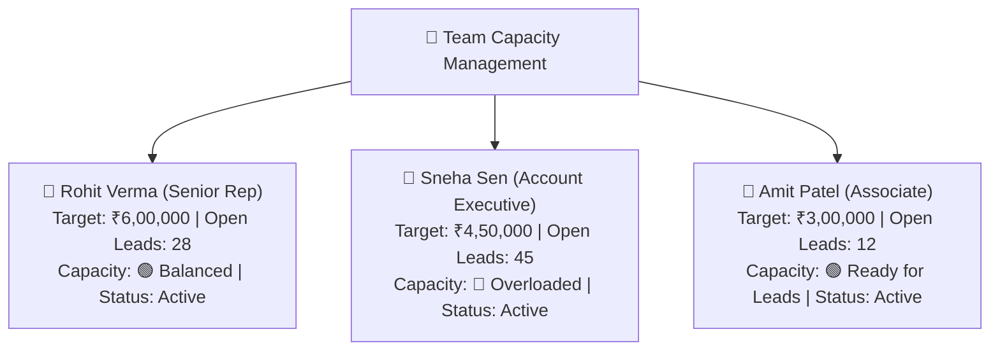

# Sales Team Roster, Quotas & Capacity Management Guide

A high-performing sales organization depends on clear expectations and balanced workloads. In HubCRM, the **Team Roster** (`/sales-manager/team`) is where you manage your people, set their monthly financial targets, and ensure no single rep is overloaded with too many leads while others sit idle.

---

## 👥 The Team Roster Screen

When you open the Team Roster, every sales representative reporting to you is displayed with their key capacity indicators:

| Column | What It Tells You |
| :--- | :--- |
| **Sales Rep Name & Role** | The team member's full name, email, and designation (e.g., *Senior Account Executive*). |
| **Monthly Revenue Quota** | Their assigned financial target for the current calendar month. |
| **Active Open Deals** | The number of opportunities they are currently working on in the pipeline. |
| **Open Leads Count** | The volume of unconverted leads assigned to them. *(Tip: Reps holding >40 open leads often struggle with response times).* |
| **Lead Routing Status** | Whether this rep is currently eligible to receive automatic incoming leads (**Active** vs. **Paused**). |

---

## 🎯 How to Set or Adjust Monthly Quotas

Setting targets is simple and transparent:

1. On the Team Roster screen, locate the rep whose target you wish to set.
2. Click the **Edit Quota (✏️)** button beside their name.
3. Enter the new monthly target value (e.g., *₹5,00,000* or *$6,500*).
4. Select the effective period (e.g., *October 2026* or *Full Q4*).
5. Click **Save Quota**.
6. **Result:** The representative's personal dashboard updates immediately, showing their new progress bar and target benchmark.

---

## ⚖️ Balancing Rep Workload & Lead Caps

If an energetic rep is receiving too many leads and cannot respond within the required 15-minute window:

1. Click on the rep's name to view their **Capacity Settings**.
2. Set a **Maximum Active Lead Cap** (for example, *30 active leads*).
3. **How It Works:** Once this rep has 30 open leads, HubCRM's automated routing system will skip them and send new inquiries to other available team members until the rep qualifies and closes their existing backlog.

---

## 🏖️ Pausing Leads When a Rep is on Leave

When a sales executive takes annual leave, sick leave, or attends offsite training:

1. In the Team Roster, find the rep's card.
2. Toggle their **Lead Routing Switch** from **Active (🟢)** to **Paused (⏸️)**.
3. **What Happens:**
   * New incoming website inquiries and marketing leads will temporarily bypass this rep.
   * Their existing pipeline deals remain safely assigned to them.
4. When the rep returns to the office, simply flip the toggle back to **Active (🟢)** to resume instant lead flow.

---

## 🗺️ Territory & Industry Specialization

If your team divides prospects by geography or industry:

1. Click **Manage Territories**.
2. Assign tags to specific reps:
   * *Aman Gupta:* **Manufacturing & Logistics**
   * *Sneha Sen:* **Healthcare & Pharma**
   * *Rohit Verma:* **Western Region (Mumbai/Pune)**
3. When a new lead arrives with matching industry or location tags, HubCRM routes the prospect directly to the specialized expert!
