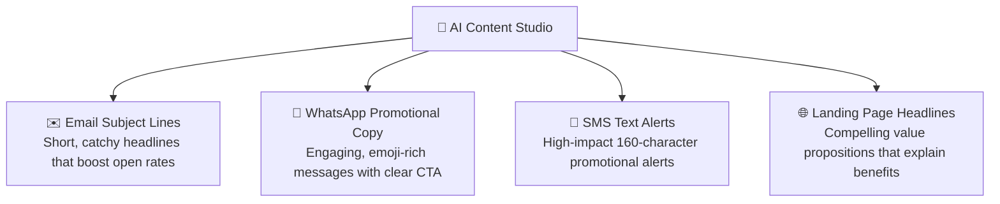

# AI Content Studio & Copywriting Guide

Writing compelling marketing copy every week can be challenging. Whether you need an irresistible email subject line, a friendly WhatsApp promotional teaser, or a crisp value proposition for a landing page, HubCRM's built-in **AI Content Studio** (`/marketing/ai-studio`) helps you generate persuasive text in seconds.

---

## 🤖 What Can AI Studio Create for You?

AI Studio is tailored specifically for B2B sales and marketing communications:

---

## ✍️ How to Generate Content in 4 Steps

Using AI Studio requires zero technical prompt skills:

1. Navigate to **Marketing ➔ AI Studio**.
2. Select your **Content Goal**:
   * *WhatsApp Promotional Offer*
   * *Email Subject Line & Body*
   * *SMS Event Announcement*
   * *Product Benefit Bullets*
3. Enter your simple product inputs:
   * **Product/Service Name:** e.g., *"HubHRMS Geo-Fencing & Attendance"*.
   * **Target Audience:** e.g., *"HR Managers and Factory Supervisors"*.
   * **Key Offer or Benefit:** e.g., *"Eliminate buddy punching and calculate monthly payroll in 2 clicks. Special 20% discount this month."*
   * **Tone of Voice:** Select *Professional, Friendly, Urgent,* or *Inspiring*.
4. Click the blue **Generate Copy (✨)** button.

---

## 📋 Reviewing & Choosing Variations

Within 5 seconds, AI Studio generates **three distinct creative variations**:

* **Option 1 (Direct & Professional):** Focuses clearly on ROI, time savings, and business efficiency.
* **Option 2 (Urgent & Promotional):** Highlights the limited-time discount and encourages immediate action.
* **Option 3 (Story & Problem-Solving):** Focuses on the customer's pain points and how your software provides relief.

### What to Do Next:
* **Edit in Place:** Click any variation to tweak a word, add your phone number, or adjust the tone.
* **1-Click Copy:** Copy the text to your clipboard.
* **Save to Templates:** Click **Save as Template** to store the approved copy directly inside your Campaign Library so sales reps and marketers can reuse it anytime!
