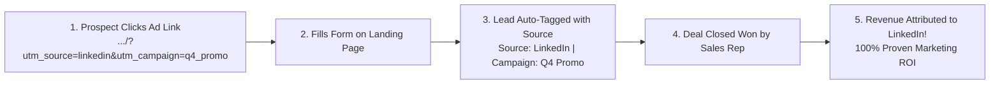

# UTM Attribution & Campaign Analytics Guide

The biggest frustration for many marketing teams is proving their direct impact on the company's bottom line. When a sales rep closes a ₹5,00,000 deal, was that customer found through a Google Search ad, a sponsored LinkedIn post, or an email newsletter?

HubCRM's **UTM Attribution & Campaign Analytics Engine** (`/marketing/analytics`) automatically tracks every visitor from their very first click all the way to finalized invoice payment.

---

## 🧭 How UTM Attribution Works

A UTM parameter is simply a small tag attached to the end of a link you share in ads, emails, or social media:

* **No Manual Work Needed:** HubCRM captures these tags silently in the background when a visitor submits any web form or landing page.

---

## 🏷️ The 3 Essential UTM Tags to Use

When sharing links to your landing pages, use HubCRM's **Built-in UTM Link Generator**:

| UTM Tag | What It Tracks | Example |
| :--- | :--- | :--- |
| `utm_source` | **Where** the traffic came from. | `google`, `linkedin`, `newsletter`, `facebook` |
| `utm_medium` | The **marketing medium** used. | `cpc` (paid ad), `email`, `social`, `referral` |
| `utm_campaign` | The **specific promotion or event**. | `diwali_promo`, `enterprise_webinar`, `spring_sale` |

### How to Generate a Tracked Link:
1. Go to **Marketing ➔ Link Generator**.
2. Paste your landing page link (e.g., `https://mycompany.com/demo`).
3. Fill in the source (e.g., *linkedin*) and campaign (e.g., *q4_enterprise*).
4. Click **Generate Link**. HubCRM gives you a ready-to-use tracked link:  
   `https://mycompany.com/demo?utm_source=linkedin&utm_medium=social&utm_campaign=q4_enterprise`

---

## 📊 Understanding Campaign Delivery Receipts

When you broadcast an Email, SMS, or WhatsApp campaign, HubCRM displays a real-time **Delivery Receipt Dashboard**:

* **Sent (100%):** Total messages successfully handed over to the telecom network.
* **Delivered (98.4%):** Messages confirmed received on the recipient's phone or inbox.
* **Opened / Read (74.2%):** Total recipients who physically opened and viewed your message.
* **Clicked (18.6%):** Prospects who clicked your link or tapped an action button.
* **Bounced / Failed (1.6%):** Invalid numbers or full inboxes (HubCRM automatically flags these to keep your contact list clean).

---

## 💰 Measuring Cost per Lead & ROI

In the **Revenue Attribution Report**:
1. Enter your total ad spend for the campaign (e.g., *₹25,000* on LinkedIn Ads).
2. HubCRM automatically calculates:
   * **Total Leads Generated:** e.g., *100 Leads*.
   * **Cost Per Lead (CPL):** e.g., *₹250 per lead*.
   * **Total Closed Deals:** e.g., *8 Deals Won*.
   * **Total Closed Revenue:** e.g., *₹3,20,000*.
   * **Return on Ad Spend (ROAS):** e.g., **12.8x Return!**

You can download this report as a crisp PDF to share directly with your Marketing Director or Board of Directors to justify future marketing budgets!
