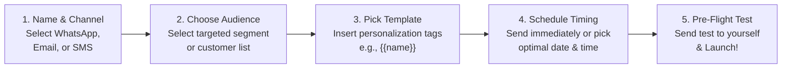

# Multi-Channel Campaign Manager Guide (Email, WhatsApp, SMS)

Modern customers don't rely on a single communication channel. Some business executives prefer an email proposal, others respond immediately to a WhatsApp alert, while time-sensitive reminders work best over SMS.

HubCRM's **Campaign Manager** (`/marketing/campaigns`) gives you an easy 5-step wizard to launch professional broadcasts across all three channels simultaneously.

---

## 🚀 The 5-Step Campaign Creation Wizard

---

## 📝 Step-by-Step Walkthrough

### Step 1: Campaign Details & Channel
1. Go to **Campaigns** and click the blue **+ Create Campaign** button.
2. Enter a clear **Campaign Name** (e.g., *"End-of-Year 20% Software Upgrade"*).
3. Select your primary broadcast channel:
   * **WhatsApp Broadcast:** Ideal for high open rates (75%–90%) and immediate conversations.
   * **Email Newsletter:** Best for detailed newsletters, product announcements, and case studies.
   * **SMS Text Blast:** Best for urgent, time-sensitive alerts and direct link clicks.

### Step 2: Target Audience Segmentation
Select who should receive your campaign:
* **All Contacts:** Entire customer directory.
* **Pre-Built Segment:** Pick a smart filter (e.g., *"Leads added this month"*, *"Lost deals from Q3"*, or *"Current VIP Accounts"*).
* **Uploaded CSV:** Upload a targeted spreadsheet of attendees from an exhibition or event.

### Step 3: Message Content & Personalization
1. Select an approved message template from your library.
2. Use dynamic merge tags so every message feels personal:
   * `{{name}}` ➔ Automatically replaced with the prospect's first name (e.g., *"Hello Priya"*).
   * `{{company}}` ➔ Replaced with their business name (e.g., *"TechCorp Solutions"*).
3. Add a clear **Call to Action (CTA)** button (e.g., *"Book a 10-Min Demo"* or *"Claim 20% Discount"*).

### Step 4: Scheduling & Throttling
* **Send Immediately:** Broadcasts start dispatching right away.
* **Schedule for Later:** Pick the optimal day and time (e.g., *Tuesday at 10:30 AM* is proven to have the highest B2B open rate).
* **Smart Throttling:** HubCRM automatically spaces out message dispatch to protect your WhatsApp Business number and comply with telecom guidelines.

### Step 5: Pre-Flight Test & Launch
1. On the preview screen, inspect how your message will look on both mobile and desktop screens.
2. Click **Send Test Message to My Number** to verify that formatting, links, and merge tags look flawless.
3. When satisfied, click **Launch Campaign**!

---

## 📈 Monitoring Live Broadcast Progress

Once launched, HubCRM provides a live delivery dashboard:

* **Progress Bar:** Real-time percentage counter (e.g., *"1,840 of 2,500 messages sent"*).
* **Delivery Rates:** Percentage of messages successfully received on client handsets.
* **Inbound Replies:** When a recipient replies to your WhatsApp broadcast, HubCRM automatically routes their reply into the **Sales Leads** inbox so a sales rep can start closing immediately!
