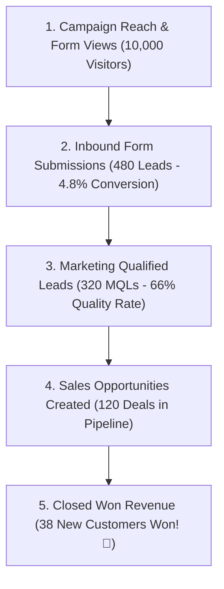

# Marketing Dashboard & Inbound Funnel Guide

The **Marketing Dashboard** (`/marketing/dashboard`) gives growth teams complete visibility into how well their promotional efforts are working. Instead of looking at vanity metrics like page visits alone, HubCRM connects your marketing spend directly to real customer inquiries and closed revenue.

---

## 📊 Core Marketing KPI Cards

At the top of your marketing screen, four summary cards display your primary campaign health metrics:

| Metric Card | What It Means | Why It Matters |
| :--- | :--- | :--- |
| **Total Inbound Leads** | Total new prospect inquiries generated across all web forms, WhatsApp broadcasts, and landing pages this month. | Measures top-of-funnel volume. |
| **Marketing Qualified (MQL)**| The number of leads that meet your minimum criteria (valid phone, business email, and verified interest). | Eliminates spam and measures lead quality delivered to sales reps. |
| **Form Conversion Rate** | The percentage of website visitors who fill out your lead capture forms (e.g., *4.8%*). | Measures how compelling your offers and landing pages are. |
| **Attributed Sales Revenue** | The total cash revenue closed by your sales team from leads originally generated by marketing campaigns! | Proves marketing return on investment (ROI). |

---

## 🌪️ The Marketing-to-Sales Conversion Funnel

The visual funnel on your dashboard shows how prospects travel from initial awareness to finalized purchase:

* **Where to Optimize:** If you have high form submissions but low sales conversions, review your qualification criteria. If your form views are low, increase campaign promotion.

---

## 📋 Active Campaigns Overview Table

Below the funnel, your **Active Campaigns Table** displays the real-time status of all active initiatives:

| Campaign Name | Channel | Audience Size | Delivery Rate | Open / Click Rate | Leads Produced | Status |
| :--- | :--- | :--- | :--- | :--- | :--- | :--- |
| **Diwali Enterprise Promo** | WhatsApp | 2,500 | 99.2% | 78.4% Open | 142 Leads | 🟢 Active |
| **Q4 Product Webinar** | Email | 8,200 | 98.7% | 24.1% Open | 96 Leads | 🟢 Active |
| **Flash Sale Alert** | SMS | 5,000 | 97.5% | 12.3% Click | 64 Leads | 🏁 Completed |

* **Real-time Status Tags:** Shows whether a campaign is **Draft**, **Scheduled**, **Broadcasting**, or **Completed**.
* **1-Click Drilldown:** Click any campaign name to inspect recipient-by-recipient delivery logs.
