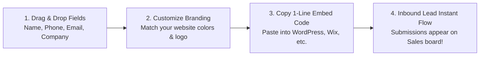

# Lead Capture Forms Builder & Embed Guide

Every visitor to your company website or blog is a potential customer. But if your contact form is clunky or requires manual copy-pasting into spreadsheets, response times suffer and leads go cold.

HubCRM's **Visual Form Builder** (`/marketing/forms`) lets you create modern, mobile-friendly lead capture forms in minutes and embed them onto any website with a single line of code.

---

## 🎨 How the Visual Form Builder Works

---

## ➕ Creating Your First Form in 4 Steps

1. Go to **Marketing ➔ Forms** and click **+ Create New Form**.
2. Give your form a name (e.g., *"Homepage Contact Us Form"* or *"2026 Demo Request Form"*).

### Step 1: Adding Form Fields
Drag fields from the left palette into your form canvas:
* **Full Name** (Required)
* **Business Email** (Required — automatically validated)
* **Phone / WhatsApp Number** (Required — with country code selector)
* **Company Name** (Required)
* **Dropdown Option:** e.g., *"Which module do you need? (HubMeet, HubCRM, HubHRMS)"*
* **Message / Inquiry Box** (Optional)

### Step 2: Customizing Visual Style
* **Theme Colors:** Pick your brand's primary color (e.g., deep purple or corporate blue) for the submit button.
* **Button Text:** Change *"Submit"* to an action-oriented phrase like *"Request Free Live Demo (2 Mins)"* or *"Get Instant Price Quote"*.
* **Success Message:** Enter what visitors see after submitting (e.g., *"Thank you! Our product specialist will call you within 15 minutes."*).

### Step 3: Automated Sales Assignment Rules
Decide what happens when a visitor submits the form:
* **Target Sales Pipeline:** Route to *Direct Inbound Sales*.
* **Lead Owner:** Select *Automated Round-Robin* so leads are shared evenly among your sales reps.
* **Instant Welcome Alert:** Enable automated WhatsApp confirmation to immediately reassure the customer.

---

## 💻 Embedding Your Form on Any Website

Once saved, HubCRM generates two simple sharing options:

1. **Option A: 1-Line Website Embed:**
   * Copy the generated JavaScript snippet (e.g., ``).
   * Paste it into your **WordPress, Webflow, Wix, Shopify, or custom HTML** website where you want the form to appear. It automatically adapts to your website's width and mobile screens!
2. **Option B: Standalone Shareable Web Link:**
   * If you don't have access to your website code, use the hosted direct link (e.g., `https://crm.srjhubnest.com/f/demo-request`).
   * Share this link directly in your social media bios, LinkedIn posts, or email signatures.

---

## 🧪 Testing Your Form

Always perform a 30-second live test:
1. Open the form link in an incognito window.
2. Enter a test name and your phone number. Click **Submit**.
3. Open **Sales ➔ Leads** in HubCRM.
4. You will see your test lead sitting proudly at the top of the queue with the tag **Source: Website Form**!
