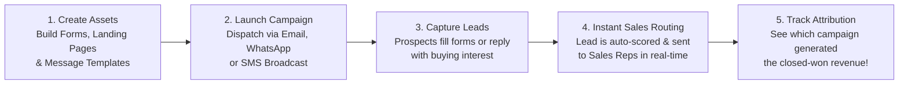

# Marketing Specialist Overview & Inbound Strategy Guide

The foundation of every growing business is a steady stream of qualified inbound leads. As a **Marketing Specialist**, your mission is to attract ideal customer prospects, engage them through personalized multi-channel messaging, and deliver sales-ready leads directly to your sales team.

HubCRM's **Marketing Hub** (`/marketing/*`) provides you with a unified platform for campaigns, landing pages, web forms, and AI-powered content generation — all connected directly to the sales CRM without messy third-party integrations.

{ width="90" }

---

## 🎯 What Does HubCRM Do for Marketers?

HubCRM eliminates the painful gaps between marketing campaigns and sales revenue:

* 🚫 **No More Disconnected Tools**: Run WhatsApp broadcasts, SMS notifications, and email blasts from the exact same dashboard where customer data lives.
* 🚫 **No More Lost Lead Inquiries**: Every form submitted on your landing pages or websites instantly creates an organized, scored lead in the sales team's queue.
* 🚫 **No More Guessing Campaign ROI**: Track UTM parameters and delivery receipts directly to closed-won sales revenue, proving the exact dollar return on your ad spend.
* 🚫 **AI-Powered Copywriting**: Generate compelling marketing copy, email subject lines, and WhatsApp templates in seconds using built-in AI Copilot.

---

## 🧭 The End-to-End Marketing Workflow

Here is how marketing campaigns operate seamlessly inside HubCRM:

---

## 🖥️ Screen Tour: Marketing Navigation

When you access HubCRM with a Marketing profile, your sidebar reveals dedicated growth tools:

| Marketing Menu Item | Icon | What You Do Here |
| :--- | :--- | :--- |
| **Marketing Dashboard** | 📊 | Real-time campaign stats: total leads generated, conversion rates, and revenue attribution. |
| **Campaign Manager** | 🚀 | Create and launch scheduled broadcasts across Email, SMS, and WhatsApp. |
| **AI Content Studio** | 🤖 | Generate persuasive ad headlines, email copy, and value propositions with AI Copilot. |
| **Lead Capture Forms** | 📋 | Drag-and-drop web form builder. Generate embed code for WordPress, Shopify, or custom websites. |
| **Landing Pages** | 🌐 | Create responsive, branded landing pages for product launches and promotional webinars. |
| **Templates & Media** | 🎨 | Manage approved WhatsApp Business templates, email layouts, and your company media library. |
| **Audience Contacts** | 👥 | Filter and segment your customer base into targeted lists (e.g., *Active Clients, Lapsed Leads, VIPs*). |
| **Campaign Analytics** | 📈 | Detailed delivery receipts (Sent, Delivered, Opened, Clicked) and UTM attribution reports. |

---

## 📚 What's in this Marketing Manual?

Follow these step-by-step guides to master your marketing campaigns in HubCRM:

1. [Marketing Dashboard & Funnels](dashboard.md): Monitor inbound pipeline, conversion rates, and campaign ROI.
2. [Multi-Channel Campaign Manager](campaign-manager.md): How to launch Email, WhatsApp, and SMS campaigns.
3. [AI Studio & Copywriting](ai-studio.md): Use AI Copilot to write high-converting copy in seconds.
4. [Visual Lead Forms Builder](forms-builder.md): Create web forms and embed them on any external website.
5. [Landing Page Builder](landing-pages.md): Launch fast, mobile-friendly landing pages without coding.
6. [Templates & Media Vault](templates-media.md): Manage WhatsApp templates and company assets.
7. [UTM Attribution & Analytics](analytics-attribution.md): Prove campaign value and track revenue return.
