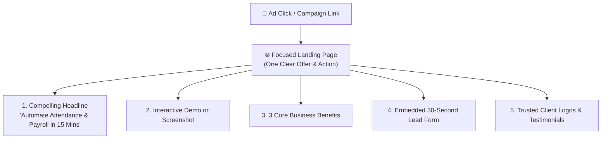

# Lead Generation Landing Page Builder Guide

When you run paid Google ads, Facebook campaigns, or sponsor an industry newsletter, directing traffic to your general company homepage often confuses visitors. A **Landing Page** (`/marketing/landing-pages`) is a focused, standalone web page built around a single offer with zero distractions.

HubCRM allows marketers to launch stunning, high-converting landing pages in minutes without needing a web developer.

---

## 🌟 Why Use Dedicated Landing Pages?

* **Higher Conversions:** Focused landing pages typically convert **15% to 25% of visitors into leads**, compared to just 2% on general homepages.
* **Instant Lead Capture:** When a visitor submits their details, a lead is instantly created in HubCRM.

---

## 🚀 How to Build a Landing Page in 4 Steps

1. Navigate to **Marketing ➔ Landing Pages** and click **+ Create Page**.

### Step 1: Choose a Pre-Built Template
Select a proven layout designed for your goal:
* **Product Demo Booking:** Clean hero section with an embedded meeting scheduler.
* **Promotional Discount Offer:** High-energy layout with a countdown timer and discount claim form.
* **Webinar Registration:** Features speaker photos, agenda points, and 1-click registration.
* **Whitepaper / Catalog Download:** Delivers a downloadable PDF brochure after the visitor enters their work email.

### Step 2: Customize Headlines & Content
Click on any text block on your screen to edit it directly:
* **Hero Headline:** Make it clear and outcome-driven (e.g., *"Eliminate Payroll Errors and Cut HR Admin Time by 80%"*).
* **Supporting Bullets:** Highlight 3 key features that address common customer headaches.
* **Social Proof:** Upload logos of prominent clients who already trust your company.

### Step 3: Connect Your Lead Form
* Select which lead capture form to feature on the page.
* Customize the button color and label (e.g., *"Claim My 14-Day Free Access"*).

### Step 4: Publish & Go Live
1. Click **Preview** to verify how the page looks on both desktop laptops and mobile smartphones.
2. Under **Page Settings**, choose your URL:
   * **Hosted Link:** `https://crm.srjhubnest.com/p/enterprise-demo`
   * **Custom Company Domain:** Connect your own domain (e.g., `offers.mycompany.com`).
3. Click **Publish Page**. Your landing page is live and ready to receive traffic!
