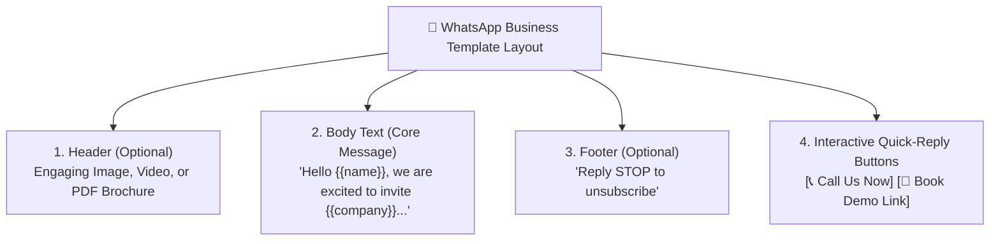

# Message Templates & Media Asset Vault Guide

Consistency and compliance are vital when communicating with thousands of customers. HubCRM's **Templates & Media Vault** (`/marketing/templates`) provides a central, organized repository where your marketing team can design, approve, and store all brand assets and message templates for the entire company.

---

## 🎨 The Media Asset Vault

Instead of having team members search through local drives or outdated email threads for company logos and brochures, the **Media Vault** stores everything securely in the cloud:

* **Official Company Logos:** Transparent PNGs, light/dark mode variations, and favicon icons.
* **Product Screenshots & Infographics:** High-resolution graphics for proposals and landing pages.
* **PDF Brochures & Catalogs:** Product specifications, pricing sheets, and case study whitepapers ready for 1-click sharing.
* **Video Links:** Product demonstration recordings and webinar replays.

### How to Upload an Asset:
1. Go to **Marketing ➔ Media Library**.
2. Drag and drop your image or PDF file into the upload zone.
3. Add a descriptive tag (e.g., *Brochure 2026, Enterprise Pricing*).
4. Click **Save**. The asset is immediately available across all email, WhatsApp, and quotation builders.

---

## 💬 Designing Official WhatsApp Business Templates

Because WhatsApp enforces strict anti-spam guidelines, outbound marketing broadcasts must use **pre-approved templates**:

### Steps to Create a Template:
1. Navigate to **Templates ➔ WhatsApp Templates** and click **+ New Template**.
2. Select the **Category**:
   * *Marketing:* Promotional offers, seasonal discounts, product updates.
   * *Utility:* Meeting confirmations, appointment reminders, quotation alerts.
3. Write your message body, inserting dynamic variables:
   * *"Hello `{{name}}`, thank you for your interest in HubNest! We have prepared a customized demonstration for `{{company}}`."*
4. Add **Interactive Buttons**:
   * **Call Phone Number:** Direct 1-tap call to your sales hotline.
   * **Visit Website:** Direct link to your calendar booking link.
5. Click **Submit for Approval**.
6. HubCRM automatically connects to Meta's WhatsApp API. Most templates are reviewed and approved within 15–60 minutes!

---

## ✉️ Designing Branded Email Templates

For email broadcasts:
1. Open the **Email Templates** tab.
2. Choose from pre-made layouts or start from scratch using the visual block builder.
3. Insert your company header, custom banner image, formatted paragraphs, and call-to-action button.
4. Save the template. It is now instantly selectable in both the Marketing Campaign Manager and by sales reps sending direct 1-to-1 proposals.
