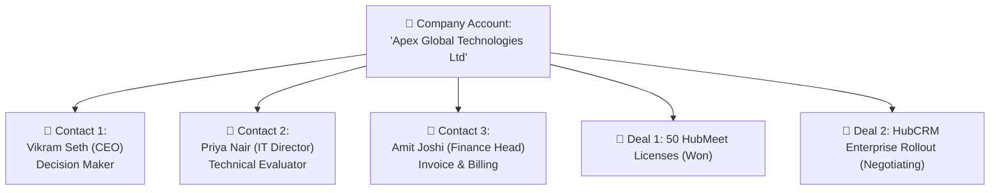

# Accounts & Contacts Directory Guide

In B2B sales, closing a deal almost always involves speaking with more than one person inside a company. For example, you might pitch your software to the **IT Manager**, negotiate pricing with the **Procurement Officer**, and receive the final signature from the **Managing Director**.

HubCRM makes managing multi-stakeholder relationships effortless through the **Accounts & Contacts** system.

---

## 🏢 Accounts vs. 👤 Contacts: What is the Difference?

Understanding the distinction is straightforward:

| Concept | What It Represents | Examples |
| :--- | :--- | :--- |
| **Account** | The **Company or Organization** as a whole. It stores high-level business data like industry, head office address, tax/GST number, and website. | *Tata Consultancy Services*, *Zomato Media Ltd*, *Global Logistics Inc*. |
| **Contact** | A **Specific Human Being** who works at that company. It stores their personal name, mobile number, job designation, and communication history. | *Rajesh Verma (VP Technology)*, *Sneha Patel (Procurement Lead)*. |

---

## 🔍 The 360-Degree Customer View

When you open any **Account** page in HubCRM (`/sales/accounts/:id`), you get a complete bird's-eye view of your company's entire relationship with that business:

1. **Company Summary Card:** Name, website link, primary office phone, billing address, and industry.
2. **Linked Contacts Roster:** A clean list of all managers and executives registered under this account, complete with 1-click WhatsApp and call buttons.
3. **Deals History:** Every deal your company has ever opened with them — past wins, active pipeline negotiations, and renewals.
4. **Billing & Invoices Tab:** View whether their invoices are paid, pending, or overdue.
5. **Unified Timeline:** Every phone call, meeting note, and email exchanged between any of your colleagues and anyone at this company.

---

## ➕ How to Add a New Contact to an Existing Company

When an existing client introduces you to their colleague or boss:

1. Open the **Account** page for that company.
2. Scroll to the **Contacts** section and click the blue **+ Add Contact** button.
3. Enter their information:
   * **Full Name:** e.g., *"Suresh Raina"*
   * **Designation / Role:** e.g., *"Chief Financial Officer"*
   * **Phone & Email:** Their direct contact details.
   * **Role Tag:** Select their buying influence (e.g., *Decision Maker, Influencer, End User, Billing Contact*).
4. Click **Save Contact**.
5. The new person is immediately linked to the company profile and visible to all sales reps.

---

## 🔎 Quick Search & Smart Filters

Finding records is instant:

* **Global Search Bar:** Type any person's name, mobile number, domain, or company name into the search bar at the very top of your screen to jump directly to their card.
* **Filter by Industry or City:** In the Accounts directory, filter by location (e.g., *Mumbai, Delhi, Bangalore*) or industry (e.g., *Manufacturing, Healthcare, IT*) to plan regional sales outreach.
* **Filter by My Accounts:** Toggle between *All Company Accounts* and *My Assigned Accounts* to focus solely on your personal client book.
