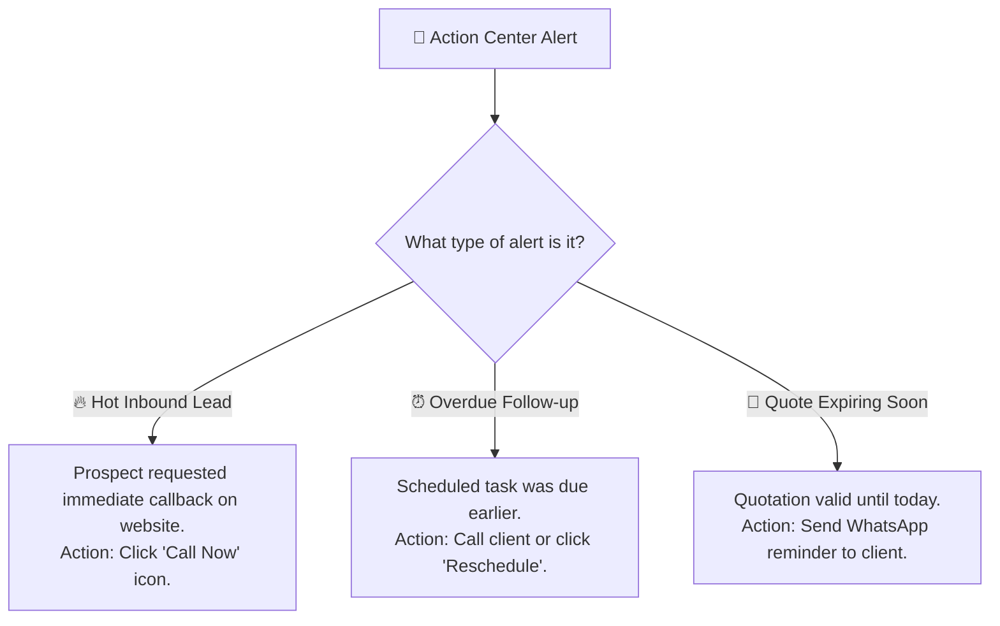

# Daily Sales Dashboard & Action Center

The **Sales Dashboard** (`/sales/dashboard`) is your morning command center. As soon as you log in, this screen tells you exactly where your attention is needed today — which leads just arrived, which deals are close to closing, and which customers are waiting for your callback.

---

## 📊 Overview of Dashboard Cards

At the very top of your screen, four summary cards give you a clear pulse of your current sales pipeline:

| Dashboard Card | What It Shows | What Action You Should Take |
| :--- | :--- | :--- |
| **New Leads Assigned** | Number of fresh prospects assigned to you in the last 24–48 hours. | Click on this card to open your new leads. Call or message them within 15 minutes for the highest response rate. |
| **Open Deals Value** | The total monetary value of all opportunities you are currently working on. | Review this number against your monthly target to ensure you have enough active opportunities in your pipeline. |
| **Tasks Due Today** | The number of scheduled callbacks, client meetings, and proposal deadlines due before end of day. | Click to see the list. Tackle high-priority callbacks before lunch. |
| **Closed Won (This Month)** | Total finalized revenue you have successfully brought in during the current month. | Celebrate your wins and track how close you are to earning your monthly sales bonus. |

---

## ⚡ High-Priority Alert Banners

Right below the summary cards, HubCRM highlights urgent items that require immediate attention:

### 1. New Inbound Inquiries
When a prospect fills out a contact form on your company's website or clicks a promotional link, a highlighted banner appears:
* **What you see:** Lead name, phone number, company name, and the specific product they asked about.
* **What to do:** Click the green **Call** button or purple **WhatsApp** button to start the conversation immediately.

### 2. Follow-ups Due Today
* Shows all prospects who requested a callback at a specific time (e.g., *"Call me on Thursday at 2:00 PM"*).
* Clicking the checkbox next to a task marks it complete and automatically records the timestamp on the client's timeline.

---

## 📈 Recent Activity Feed

On the right side of your dashboard, the **Live Activity Feed** displays a real-time chronological stream of interactions:

* **Email Opened:** You will see when a prospect opens an email proposal you sent them. *(Tip: Calling a client within 10 minutes of them opening your proposal often leads to an instant closing conversation!)*
* **Quote Viewed:** Alerts you when a decision-maker views your online quotation.
* **Inbound WhatsApp Message:** Notifies you when a client replies to your message.

---

## 📋 Step-by-Step: Your 5-Minute Morning Routine

Follow these four simple steps every morning when opening your dashboard:

1. **Check 'Tasks Due Today':** Review your scheduled phone calls and client demonstrations.
2. **Review 'New Leads Assigned':** Open any newly received leads and verify their contact details.
3. **Scan 'Expiring Quotes':** Check if any proposals sent earlier this week are waiting for a customer signature.
4. **Inspect Pipeline Balance:** Verify that you have deals moving through every stage (Meeting ➔ Proposal ➔ Negotiation).

!!! tip "Customizing Your View"
    You can filter the dashboard by date range (e.g., *Today*, *This Week*, *This Month*) using the dropdown in the top-right corner.
