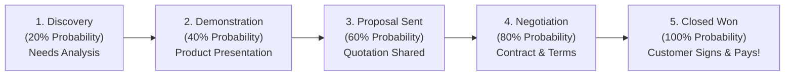

# Deal Pipeline & Kanban Board Guide

Once a lead is qualified, it enters your **Deal Pipeline** (`/sales/deals`). The Deal Pipeline is a visual, interactive board where every business opportunity is represented as a movable card organized into sequential sales stages.

Using this board, you and your sales manager can instantly see the total revenue in your pipeline, which deals are progressing smoothly, and which deals need a friendly nudge.

---

## 🧭 The 5 Stages of a Deal

Every deal travels through five standard stages from start to finish:

| Stage Name | Probability | What Happens During this Stage |
| :--- | :--- | :--- |
| **1. Discovery & Meeting** | 20% | You have confirmed the customer is interested. You are holding an initial discovery call to understand their team size, software needs, and budget. |
| **2. Demo & Presentation** | 40% | You demonstrate HubNest to key decision-makers, showcasing the exact features that solve their problems. |
| **3. Proposal / Quotation** | 60% | You have shared an official price quote, license count, and payment terms. The customer is reviewing the commercial proposal with their finance team. |
| **4. Negotiation & Review** | 80% | The client has agreed in principle. You are finalizing minor contract terms, payment timelines, or manager-approved discount vouchers. |
| **5. Closed Won** | 100% | The contract is signed, the payment or advance is received, and the client officially joins your company family! 🎉 |

---

## 🖱️ Drag-and-Drop: Moving Deals Between Stages

Advancing an opportunity is completely intuitive:

1. Click and hold the **Deal Card** on your board.
2. Drag the card horizontally across columns to its new stage (e.g., from *Demo Scheduled* to *Proposal Sent*).
3. Release your mouse button to drop the card into the new column.
4. HubCRM automatically recalculates the column totals and updates your weighted revenue forecast in real time.

---

## 📝 What Information is on a Deal Card?

Each card on your board displays the essential facts at a glance:

* **Deal Name & Company:** e.g., *"Apex Logistics — 50 Workspace Licenses"*.
* **Deal Value:** e.g., *₹1,80,000* or *$2,400*.
* **Primary Contact:** Name of the decision-maker and their phone number.
* **Expected Close Date:** When the customer expects to finalize payment (highlighted in red if overdue).
* **Next Scheduled Action:** e.g., *"Call Tuesday at 11 AM regarding revised quote"*.

---

## 🎉 How to Mark a Deal as 'Closed Won'

When a customer accepts your proposal and makes a payment:

1. Drag the deal card into the green **Closed Won** column (or open the deal and click **Mark Won**).
2. A confirmation window will appear:
   * **Final Closing Amount:** Confirm the final contracted price.
   * **Close Date:** Today's date.
   * **Winning Factors (Optional):** Select why they bought (e.g., *Better features, Faster support, Best pricing*).
3. Click **Confirm Win**.
4. **What Happens Next:**
   * Your personal achievement tracker immediately credits your closed revenue.
   * A notification is automatically sent to the **Finance & Billing** team so they can issue the official tax invoice.
   * Your Sales Manager receives a celebration notification on their dashboard!

---

## ⚠️ What Happens if a Deal is Lost?

Sometimes a client decides not to purchase or postpones their project. When this happens:

1. Drag the card into the red **Closed Lost** column.
2. HubCRM will ask you to select a quick **Loss Reason**:
   * *Chose a competitor*
   * *Budget cut / Project postponed*
   * *Features did not match requirement*
   * *Unresponsive / Ghosted*
3. Enter a 1-sentence note explaining what happened.
4. Click **Confirm Lost**.

!!! note "Why do we record loss reasons?"
    Recording honest loss reasons helps your product and marketing teams understand how to improve pricing or add missing features. It also allows you to re-open the deal six months later when the client's budget reopens!
