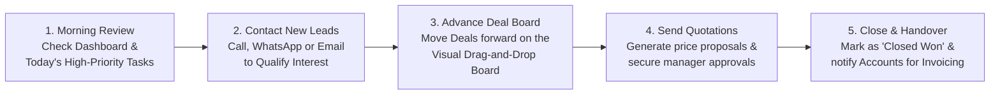

# Sales Executive Overview & Daily Routine Guide

Welcome to the **HubCRM Sales Representative Guide**. As a sales executive, your primary mission is to turn interested prospects into happy, paying customers. HubCRM is designed to give you everything you need in one clean, easy-to-use workspace — without confusing technical jargon or complicated spreadsheets.

{ width="90" }

---

## 🎯 What Does HubCRM Do for You?

HubCRM takes away the frustrating manual busywork so you can focus on building relationships and closing deals:

* 🚫 **No More Lost Contacts**: Every phone number, email address, WhatsApp conversation, and call recording is saved automatically in one customer profile.
* 🚫 **No More Forgotten Follow-ups**: HubCRM automatically reminds you when a lead needs a callback, when a quotation is expiring, or when a meeting is scheduled.
* 🚫 **No More Manual Data Entry**: Convert an interested lead into an active deal, company account, and contact person with a single click.
* 🚫 **1-Click Communication**: Call customers directly from your screen, dispatch pre-approved WhatsApp messages, and send SMS updates without switching between apps.

---

## 🧭 How Your Daily Sales Workflow Works

Here is the simple, proven daily routine recommended for top-performing sales executives in HubCRM:

---

## 🖥️ Screen Tour: Your Daily Navigation

When you log into HubCRM, your left navigation menu provides immediate access to your essential sales tools:

| Menu Item | Icon | What You Do Here |
| :--- | :--- | :--- |
| **Sales Dashboard** | 📊 | See your daily snapshot: new leads assigned to you, deals in progress, today's callbacks, and target progress. |
| **Leads** | 🎯 | View all people who have expressed interest in your product or service. Review their background and qualify them. |
| **Deals (Pipeline)** | 💼 | Visual Kanban board showing every active sales opportunity organized by stages (from initial meeting to deal won). |
| **Accounts & Contacts**| 🏢 | Your permanent address book containing verified corporate clients, decision-makers, and company profiles. |
| **Tasks & Calendar** | 📅 | Your daily to-do list: follow-up calls, scheduled Zoom/HubMeet demos, and deadline reminders. |
| **Communications** | 💬 | Recent WhatsApp chats, SMS dispatch history, and inbound customer queries. |
| **Quotes & Proposals** | 📄 | Price proposals, discount requests, and contracts sent out to customers. |
| **My Targets** | 🏆 | Your monthly quota tracker, commission forecasts, and personal sales achievements. |

---

## 💡 Quick Tips for Daily Success

!!! tip "Start Your Day in 'Tasks Today'"
    Always check **Sales Tasks ➔ Today's Follow-ups** first thing every morning. Reaching out to prospects at the exact time you promised builds immediate trust and significantly boosts deal conversion.

!!! note "Every Call and Chat Counts"
    When you speak with a client, click **Log Activity** to leave a 1-sentence note (for example: *"Discussed 20-license plan; customer requested quote by Friday"*). This ensures that if you are away, your teammates can seamlessly support your client.

!!! important "Always Advance Deals Step-by-Step"
    When a customer agrees to a proposal, drag their card on the **Deals Board** to the next stage. This immediately alerts your sales manager that revenue is on track for the month.

---

## 📚 What's in this Sales Manual?

Follow the step-by-step guides in this section to master every aspect of your daily sales role:

1. [Daily Sales Dashboard](dashboard.md): Understand your key numbers, alerts, and today's priorities.
2. [Lead Qualification & Scoring](lead-qualification.md): How to capture, score, and contact new prospects.
3. [Drag-and-Drop Deal Pipeline](deal-pipeline.md): Visual deal stages, moving cards, and tracking deal values.
4. [Converting Leads to Customers](lead-conversion.md): Step-by-step walkthrough of turning a lead into a real deal.
5. [Accounts & Contact Directory](accounts-contacts.md): Finding company details, decision-makers, and historical logs.
6. [Click-to-Call, WhatsApp & SMS](omnichannel-engagement.md): Using integrated phone calls and message templates.
7. [Follow-ups & Task Reminders](task-management.md): Never miss a meeting or callback.
8. [Quotations & Proposals](quotations-proposals.md): Sending price breakdowns and obtaining discount approvals.
9. [Tracking Personal Targets](profile-targets.md): Monitoring your commission, closed revenue, and settings.
