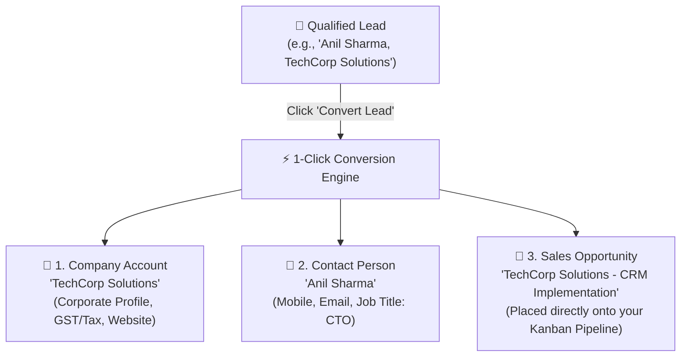

# Converting Qualified Leads to Deals, Accounts & Contacts

During initial outreach, a prospect lives in the **Leads** section. But once that prospect confirms they have an active project, budget, and timeline, keeping them as a simple lead is no longer sufficient.

HubCRM features a **1-Click Conversion Engine** that transforms temporary lead records into three organized, permanent business entities with zero manual re-typing.

---

## 🧩 The Conversion Magic: 1 Click = 3 Records

When you convert a lead, HubCRM automatically links and creates three distinct records in your database:

1. **The Account (Company Profile):** The legal or corporate business entity. All future deals, multiple employee contacts, invoices, and contracts will link here.
2. **The Contact Person:** The specific human being you spoke with (phone number, email address, job title, and notes).
3. **The Deal Opportunity:** An active card created directly on your **Deals Board** at the *Discovery* stage with the estimated value.

---

## 📋 Step-by-Step: How to Convert a Lead

Follow these simple steps when a prospect is ready for a formal sales cycle:

1. Open the lead profile from **Leads** (`/sales/leads`).
2. Verify that their **Email Address**, **Phone Number**, and **Company Name** are filled in accurately.
3. In the top-right action header, click the prominent blue button labeled **Convert to Deal**.
4. A quick confirmation modal will appear with pre-filled details:
   * **Company Account:** Choose to *Create New Account* (e.g., "TechCorp Solutions") or *Attach to Existing Account* if your company has previously worked with this business.
   * **Contact Name:** Confirms the person's name and title.
   * **Deal Name:** Defaults to *"[Company Name] — New Opportunity"*. You can rename this to something descriptive (e.g., *"TechCorp — 35 User Enterprise Plan"*).
   * **Deal Amount:** Enter the estimated project value or package price.
   * **Target Close Date:** Pick an estimated closing date (e.g., end of current month).
   * **Pipeline Selection:** Select which sales pipeline to place them in (e.g., *Direct Sales*, *Partnership*, or *Enterprise*).
5. Click **Confirm & Convert**.

---

## 🔒 What Happens to Historical Notes and Calls?

You never have to worry about losing conversation history! When a lead is converted:

* ✅ Every call recording, note, WhatsApp message, and file attachment from the original lead is **automatically transferred** to the new Deal and Contact timeline.
* ✅ The original lead status changes to **Converted**, preventing duplicate follow-ups by other sales reps.
* ✅ You are immediately redirected to the newly created Deal page so you can schedule the product demo or draft the initial quotation right away.

---

## 🔍 Avoiding Duplicate Companies

If your company has already registered this business previously, HubCRM's smart duplicate detection alerts you:

> **"Existing Account Found:** We found a company named *TechCorp Solutions* created by Sales Rep Rohit. Would you like to add this new deal under the existing company account?"

Simply click **Link to Existing Account**. This ensures that multiple sales reps do not create conflicting duplicate company profiles while still allowing you to own and close your specific deal!
