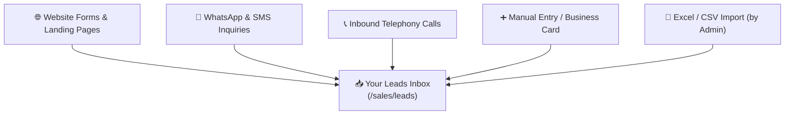

# Lead Qualification & Temperature Scoring Guide

In HubCRM, a **Lead** is anyone who has shown initial interest in your business — such as filling out a website inquiry form, sending a message on WhatsApp, visiting an exhibition booth, or requesting a price quote.

Your goal during the **Lead Qualification** stage is simple: contact the lead, understand what they need, determine if they have the budget and authority to buy, and decide if they are ready to become a real sales deal.

---

## 📥 Where Do Leads Come From?

Leads arrive in your HubCRM inbox automatically through several channels:

---

## ➕ How to Add a New Lead Manually

If you meet a potential client at a meeting, an event, or receive a direct referral, you can create their lead profile in under 60 seconds:

1. Click on **Leads** in the left sidebar menu.
2. Click the blue **+ Add New Lead** button in the top-right corner.
3. Fill in the simple details:
   * **Full Name:** Customer's first and last name.
   * **Company Name:** Organization or business they represent.
   * **Phone Number:** Mobile or direct office number. *(Ensure country code is selected for 1-click WhatsApp and calling).*
   * **Email Address:** Business email address.
   * **Lead Source:** Select where you found them (e.g., *Website, Referral, Event, Cold Outreach*).
   * **Estimated Value:** If they mentioned a budget or project size, enter an approximate figure.
4. Click **Save Lead**. The new lead will instantly appear at the top of your list.

---

## 🌡️ Understanding Lead Temperature (Scoring)

Not all leads are ready to purchase on day one. HubCRM uses a simple, color-coded temperature rating so you know who to prioritize first:

| Rating | Icon | What This Means | How to Handle This Lead |
| :--- | :--- | :--- | :--- |
| **Hot** | 🔥 | **High buying intent.** The customer has an urgent requirement, an approved budget, and wants to see a demonstration or price quote immediately. | **Call within 15–30 minutes.** Send a personalized proposal the same day. Advance directly to the Deals pipeline. |
| **Warm** | 🟡 | **Interested but evaluating.** The customer likes your offering but is comparing competitors or waiting for internal approval next month. | Schedule a follow-up demo next week. Send them product brochures or customer case studies. |
| **Cold** | ❄️ | **Early research or low budget.** The customer was only curious or does not have immediate funds right now. | Set a reminder to check back in 30–60 days. Place them in your marketing email newsletter campaign. |

---

## 📞 Conducting Your First Qualification Call

When opening a lead profile, you will see a prominent action bar with communication buttons:

1. **Click the Phone Icon (📞):** HubCRM initiates an instant outbound call through your computer headset or softphone.
2. **Click the WhatsApp Icon (💬):** Opens a pre-approved introductory template message (e.g., *"Hello Priya, thank you for reaching out to HubNest. When would be a good time for a 5-minute introductory call?"*).
3. **During or after the conversation:** Click **Log Call Note** to record what was discussed:
   * What problems are they trying to solve?
   * How many team members will use the software?
   * When do they need this live?

---

## 🏷️ Setting the Lead Status

After contacting the lead, update their **Status** dropdown so your manager and teammates know the current situation:

* **New:** Prospect has just arrived and has not been contacted yet.
* **Contacted:** You called or messaged them and are awaiting a response.
* **Meeting Scheduled:** Date and time confirmed for a full demonstration.
* **Qualified:** Customer has confirmed budget, timeline, and interest. *(Ready to convert into a Deal!)*
* **Unqualified / Lost:** Customer is not a good fit, wrong phone number, or no budget. *(Archive with a short reason).*

!!! tip "Quick Follow-up Rule"
    If a lead does not answer your first phone call, do not delete them! Change status to **Contacted**, send a polite WhatsApp follow-up, and schedule an automatic task reminder to call again tomorrow morning.
