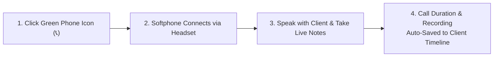

# Omnichannel Engagement: VoIP Phone, WhatsApp & SMS Guide

Modern sales reps lose hours every week dialing 10-digit phone numbers manually on mobile devices, typing repetitive WhatsApp messages, and forgetting what was discussed two weeks ago.

HubCRM integrates **VoIP Telephony**, **WhatsApp Messaging**, and **SMS Texting** directly into your browser window, turning your computer into an all-in-one customer communications center.

---

## 📞 1-Click Telephony Calling (VoIP Softphone)

Whenever you see a customer's phone number on a Lead, Contact, or Deal card, you will notice a green **Phone Icon (📞)** beside it.

### How to Place a Call:
1. Put on your computer headset.
2. Click the green **Phone Icon (📞)** next to any contact's number.
3. The integrated softphone bar will slide out at the bottom of your screen:
   * **Mute (🎤):** Silence your microphone if you need to cough or check a fact with a colleague.
   * **Hold (⏸️):** Place the client on pleasant hold music while you confirm technical details.
   * **Keypad (🔢):** Dial extension numbers or interactive IVR options (e.g., *"Press 1 for Sales"*).
   * **End Call (🔴):** Hang up when your conversation is finished.
4. **Instant Call Note Pop-Up:** As soon as you hang up, a quick note box asks: *"What was the outcome of this call?"* Select a quick tag (e.g., *Connected - Interested, Left Voicemail, Busy / Callback Later*) and type a 1-sentence summary.

!!! tip "Automatic Call Recording"
    If enabled by your company administrator, client calls are automatically recorded and attached to the timeline. You can click **Play** at any time to re-listen to specific customer requirements before a proposal presentation!

---

## 💬 1-Click WhatsApp Messaging

HubCRM bridges directly with **HubNotification** and the official WhatsApp Business API, allowing you to message clients without picking up a personal mobile phone:

1. Click the purple **WhatsApp Icon (💬)** next to any client's name.
2. A messaging window opens with two options:
   * **Option A: Pre-Approved Template:** Choose from official company templates that pull in the customer's name automatically (e.g., *Meeting Confirmation, Product Catalog, Price Proposal Sent, Callback Reminder*).
   * **Option B: Free-Text Chat:** Type your personal message directly if the client has messaged you within the last 24 hours.
3. Click **Send Message**.

### Real-Time Delivery Checkmarks
Just like on your personal phone, HubCRM shows message statuses:
* **One Grey Tick (✓):** Sent from server.
* **Two Grey Ticks (✓✓):** Delivered to customer's handset.
* **Two Blue Ticks (✓✓):** Read by customer!

---

## 📱 Outbound SMS Text Messages

For clients in regions with low internet connectivity or for sending quick confirmation links:

1. Click the **SMS Icon (✉️)** on the contact card.
2. Select your message template (e.g., *"Your demo is confirmed for today at 3:00 PM. Click here to join: meet.srjhubnest.com/demo"*).
3. Click **Send SMS**. The message is dispatched through HubCRM's high-speed SMS gateway.

---

## 📜 Everything Stays on the Timeline

The greatest benefit of communicating through HubCRM is that **you never have to copy-paste chat histories**:

* Every phone call duration (e.g., *"Call with Rajesh Verma — 4 mins 12 secs"*),
* Every WhatsApp proposal sent, and
* Every customer response

...is automatically time-stamped and saved on that customer's permanent record. Even if you go on vacation, your teammates can see the exact conversation state and assist your client without asking repetitive questions!
