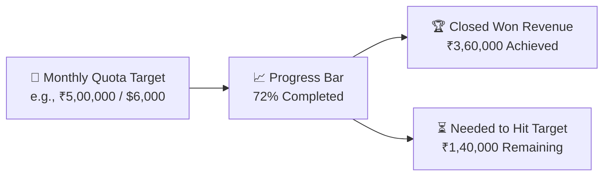

# Sales Targets, Quota Tracking & Rep Profile Guide

Every professional sales career is built on knowing your numbers and celebrating your achievements. In HubCRM, you do not need to wait until the end of the month to ask your manager how much revenue you have closed or whether you hit your sales bonus.

The **My Targets & Performance** screen (`/sales/profile`) gives you transparent, real-time visibility into your personal quota progress and career milestones.

---

## 🎯 Understanding Your Target Metrics

At the top of your profile dashboard, you will find your primary performance gauges:

| Performance Gauge | What It Means | Why It Matters |
| :--- | :--- | :--- |
| **Monthly Target** | The total revenue quota set for you by your Sales Manager for the current calendar month. | Your baseline performance benchmark. |
| **Achieved Revenue** | The sum total of all deals you have successfully moved to **Closed Won** this month. | Determines your bonus and commission eligibility. |
| **Pipeline Coverage** | The total value of active deals currently sitting in your *Proposal* and *Negotiation* stages. | A healthy pipeline should be **3x your remaining quota** to guarantee target achievement. |
| **Average Win Rate** | The percentage of your qualified leads that successfully result in a closed deal (e.g., *28%*). | Highlights your closing efficiency. |

---

## 💰 Commission & Incentives Calculator

Below your quota progress bar, the **Earnings & Bonus Estimator** calculates your anticipated incentives:

* **Base Commission:** Earned on all closed revenue once your minimum threshold is achieved.
* **Accelerator Bonus:** Extra bonus percentage applied automatically if you exceed 100% or 120% of your monthly quota!
* **Leaderboard Rank:** Shows your current ranking among your sales team colleagues (e.g., *#2 of 12 Sales Reps this month*).

---

## ⚙️ Managing Your Sales Profile & Preferences

To ensure clients receive professional communications from your name:

### 1. Updating Contact Details & Photo
1. Click your name/avatar in the top-right corner and select **My Profile** (`/sales/profile`).
2. Upload a friendly, professional photo. This photo will appear on quotation headers and customer WhatsApp message signatures.
3. Verify your direct extension and mobile phone number for the integrated VoIP softphone.

### 2. Custom Email & WhatsApp Signature
* Add your official job title (e.g., *"Senior Corporate Account Executive"*).
* Add your direct booking link (e.g., *"Book a 15-minute demo: meet.srjhubnest.com/priya"*).

### 3. Notification Settings
Choose how HubCRM alerts you when important events happen:
* **Instant Bell Notification:** Pops up on your screen when a new lead is assigned to you.
* **Mobile WhatsApp / SMS Alert:** Receive a text notification when a high-value customer accepts your price proposal.
* **Daily Morning Digest:** An email delivered at 8:30 AM summarizing your tasks and meetings for the day ahead.

### 4. Account Security & Password
* Under **Security Settings**, you can update your login password.
* Enable **Two-Factor Authentication (OTP / MFA)** to ensure your client leads and customer contact information remain strictly secure.
