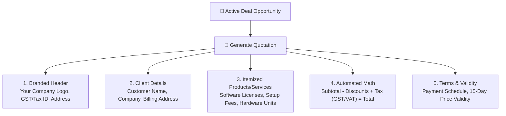

# Quotations, Price Proposals & Discount Approvals Guide

When a customer expresses serious buying intent, sending a clean, professional, and accurate price proposal quickly is the key to closing the deal before competitors can intervene.

HubCRM allows you to generate branded, itemized quotations directly inside any active deal in less than two minutes.

---

## 📄 The Anatomy of a HubCRM Quotation

Every quotation generated in HubCRM includes all essential commercial elements automatically:

---

## ➕ How to Create a New Quotation

1. Open your active deal from **Deals** (`/sales/deals`).
2. Scroll to the **Quotations** tab and click **+ New Quote**.
3. Fill in the commercial details:
   * **Quote Title:** e.g., *"HubNest Enterprise 50-User Annual Contract"*.
   * **Validity Period:** Select how long the price is valid (default is usually 15 or 30 days).
   * **Currency:** Select your transaction currency (e.g., INR ₹, USD $, EUR €).

### 4. Adding Line Items
Click **+ Add Line Item** for each product or service:
* **Item Name:** Pick an existing product from your catalog (e.g., *HubCRM Enterprise User License*) or type a custom service name (e.g., *Custom Data Migration & Onboarding*).
* **Quantity (Qty):** Enter the number of units/seats (e.g., *50*).
* **Unit Price:** Enter the standard price per unit.
* **Tax Rate (GST / VAT):** Select the applicable tax rate (e.g., *18% GST* or *0% Export*). HubCRM calculates the exact tax amounts automatically.

---

## 🏷️ Applying Discounts & Manager Approvals

If a customer asks for a discount to close the deal today:

1. In the **Discount** box, choose either **Percentage (%)** or **Flat Amount (₹/$)**.
2. Type in the discount value (e.g., *10%*).
3. HubCRM recalculates the final total immediately.

### What Happens if a Discount Exceeds Policy?
Most companies have a maximum discount policy (for example, reps can offer up to 10%, but 15% requires manager approval):
* If your discount is within your allowed limit, the quote is approved instantly.
* If your discount exceeds your threshold, a banner will indicate:
  > **⚠️ Manager Approval Required:** *This quote contains a 15% discount. Clicking 'Submit for Approval' will send an instant alert to your Sales Manager.*
* Your manager can click **Approve** on their phone or desktop in seconds, unlocking the quotation for immediate dispatch!

---

## 📤 Sending the Proposal to Your Client

Once the quotation is finalized:

1. Click **Preview PDF** to inspect the finished document. It will feature your company's official logo, payment bank details, and formal terms.
2. Choose your dispatch method:
   * **Send via WhatsApp (💬):** Dispatches a pre-formatted message with a secure link allowing the customer to view and download their quotation on their phone.
   * **Send via Email (✉️):** Sends a branded email with the PDF attached and a direct button for the client to accept the quote online.
   * **Download PDF (📥):** Save a copy to your computer to print or attach manually.

---

## 🤝 When the Customer Accepts the Quote

When your customer says *"Yes, we accept the proposal!"*:
1. Open the quotation and click **Mark as Accepted**.
2. HubCRM will ask: *"Would you like to mark the linked deal as Closed Won and notify Accounts to issue the invoice?"*
3. Click **Yes, Proceed**.
4. The deal advances to **Closed Won**, your sales quota reflects the victory, and the invoice is queued for final payment collection!
