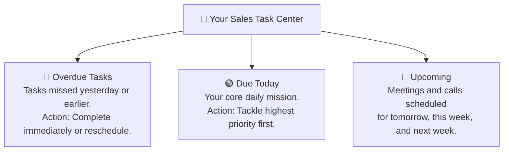

# Sales Task Management & Follow-up Scheduling Guide

In professional sales, **the fortune is in the follow-up**. More than 60% of all deals close only after the fourth or fifth interaction with a prospect. If you rely on memory or sticky notes, critical callbacks will inevitably fall through the cracks.

HubCRM's **Task Management** tool (`/sales/tasks`) acts as your personal digital assistant, ensuring every promise you make to a prospect is tracked, reminded, and completed on time.

---

## 📅 The 4 Main Types of Sales Tasks

Whenever you interact with a prospect, you can schedule one of four task types:

| Task Type | Icon | Best Used For |
| :--- | :--- | :--- |
| **Phone Callback** | 📞 | When a customer says: *"I'm in a meeting right now, please call me back at 4:30 PM."* |
| **Product Demo / Meeting** | 💻 | Scheduled video meeting or in-person demonstration with stakeholders. |
| **Send Proposal / Quote** | 📄 | When you promise to send a customized price breakdown before the end of the day. |
| **General Reminder** | ⏰ | Follow-up check-ins (e.g., *"Check if client reviewed contract with their legal team"*). |

---

## ➕ How to Schedule a Follow-up Task

You can create a task from anywhere in HubCRM — directly on a Lead, a Deal, or from the main Tasks menu:

1. Click the **+ Add Task** button (or click the calendar icon inside any lead or deal card).
2. Fill in the straightforward fields:
   * **Task Title:** Give it an actionable name (e.g., *"Callback Amit re: 15% annual discount"*).
   * **Task Type:** Select *Call, Meeting, Email,* or *Proposal*.
   * **Due Date & Time:** Choose the exact date and time agreed upon with the customer.
   * **Priority:** Select *Urgent, High,* or *Normal*.
   * **Associated Record:** Link the task to the specific customer lead or deal (HubCRM pre-fills this automatically if you are already inside that deal).
   * **Reminder Alert:** Choose to receive an in-app popup alert 15 minutes before the task is due.
3. Click **Save Task**.

---

## 📋 Managing Your Daily To-Do List

When you open **Tasks & Calendar** (`/sales/tasks`), your tasks are organized into three intuitive tabs:

### 1. Completing a Task
When you finish a phone call or meeting:
* Click the round checkbox next to the task name.
* The task is instantly marked **Completed** (with a green checkmark).
* HubCRM automatically logs the completion timestamp on the client's timeline so your sales manager knows the follow-up was honored.

### 2. Rescheduling When a Client Postpones
If you call a client and they ask: *"Can we please do this on Friday instead?"*:
1. Click the three dots (⋮) on the task card.
2. Click **Reschedule**.
3. Pick the new date and time.
4. Click **Update**. The task will quietly move to Friday's schedule without polluting your overdue list.

---

## 💡 Best Practices for Task Mastery

!!! tip "Never Leave a Deal Without a Next Step"
    Whenever you finish a call or move a deal stage, ask yourself: *"When is our next touchpoint?"* **Always create a future task before closing the window**, even if it is just a check-in reminder for two weeks from now. Deals with an active future task close 3x more often than deals left open with no next steps!

!!! important "Morning Routine"
    Filter your tasks by **Priority: High** every morning to ensure critical high-value client callbacks are addressed before your calendar fills up with afternoon meetings.
