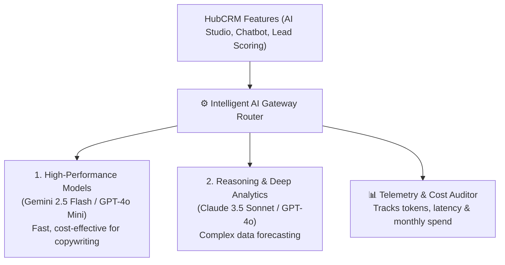

# AI Model Telemetry, Token Usage & Cost Auditing Guide

HubCRM incorporates artificial intelligence across multiple tools — from the **Marketing AI Copywriting Studio** to **Conversational AI Sales Copilots** and predictive lead scoring. 

The **AI Telemetry Center** (`/super-admin/ai-telemetry`) gives Super Admins full visibility into token consumption, model latencies, and operating costs across all customer tenants.

---

## 🤖 The AI Architecture in HubCRM

---

## 📊 Core Telemetry Metrics Monitored

| Telemetry Gauge | What It Tracks | Administrator Benefit |
| :--- | :--- | :--- |
| **Total Tokens Consumed** | Aggregate prompt (input) and completion (output) tokens processed this month. | Tracks usage volume trends. |
| **Average Query Latency** | Response time in milliseconds (e.g., *680ms*). | Ensures users experience fast, real-time responses. |
| **Monthly Model Cost** | Real-time dollar spend across AI providers. | Prevents unexpected cloud bill surprises. |
| **Top Tenant Users** | Breakdown of which client organizations use AI tools most heavily. | Identifies candidate tenants for enterprise plan upgrades. |

---

## 🛑 Enforcing Tenant AI Quotas & Fair-Use Limits

To prevent an abusive tenant or automated script from exhausting your AI budget:

1. In the AI Telemetry screen, click **Tenant Quota Policies**.
2. Set a **Monthly Token Allowance** per plan tier:
   * **Starter Plan:** 50,000 tokens / month.
   * **Professional Plan:** 500,000 tokens / month.
   * **Enterprise Plan:** 5,000,000 tokens / month (or custom volume).
3. **Automated Soft & Hard Caps:**
   * At 80% usage: Tenant admin receives a polite notification to upgrade their allowance.
   * At 100% usage: Automated rate-limiting protects your platform from runaway costs while allowing core non-AI CRM features to continue uninterrupted!
