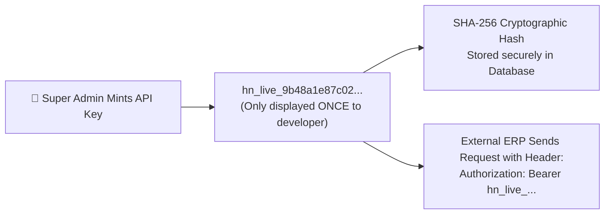

# Developer API Key Management & Token Minter Guide

Enterprise clients frequently need to connect HubCRM with external ERP systems (like SAP or Oracle), proprietary customer mobile apps, or custom automated data pipelines. Rather than sharing username-and-password credentials, HubCRM provides a **Developer API Key Subsystem** (`/super-admin/api-keys`).

---

## 🔑 Anatomy of an API Key (`hn_live_*`)

HubCRM follows industry-standard cryptographic token security:

* **Prefix:** All production developer tokens begin with `hn_live_` for instant recognition in code repositories.
* **One-Way Cryptographic Hashing:** The database only stores a SHA-256 hash. Even if an attacker accesses database backups, the raw API key cannot be decrypted!

---

## ➕ How to Issue a New API Key

1. Navigate to **Super Admin ➔ API Keys** and click **+ Generate API Key**.
2. Fill in the token metadata:
   * **Key Description / Name:** e.g., *"Apex Logistics — SAP ERP Connector"*.
   * **Associated Tenant Organization:** Select which company workspace this key will access (all API calls are strictly scoped to this tenant).
   * **Expiry Date:** Select *90 Days*, *1 Year*, or *Never Expire*.
3. **Select Granular Scopes:**  
   Limit the token to only what the developer needs:
   * `leads:read`, `leads:write`
   * `deals:read`, `deals:write`
   * `contacts:read`
4. **Set Rate Limits:** e.g., *100 requests per minute* to protect server stability.
5. Click **Generate Key**.

### ⚠️ The One-Time Copy Warning
A modal pops up displaying the secret token:  
> **Copy Your API Key Now:** `hn_live_7c41e89b21fa403...`  
> *For security reasons, this key will NEVER be shown again once you close this window. Store it securely in your environment variables.*

---

## 🚫 Revoking a Compromised Token

If a developer accidentally commits an API key to a public GitHub repository or employee laptop is lost:

1. Locate the key in the API Management table.
2. Click the red **Revoke Key (🚫)** button.
3. The token is instantly deleted from the authorization cache. Any future API calls using that key will be rejected immediately with `401 Unauthorized`.
