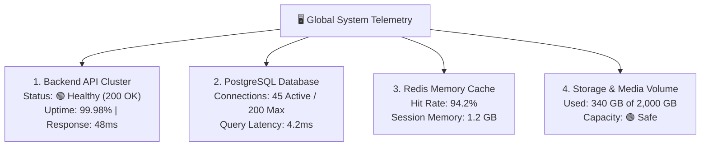

# System Health, Infrastructure Telemetry & Error Logs Guide

Ensuring 99.9% uptime for thousands of concurrent sales reps and customer support agents requires proactive infrastructure monitoring. The **System Health & Telemetry Center** (`/super-admin/system-health`) provides platform operators with real-time vitals on backend services, database connections, and error logs.

---

## 🖥️ Core Infrastructure Vitals

---

## 🔍 How to Read the System Diagnostics

When you open `/super-admin/system-health`, the diagnostics dashboard displays four real-time gauges:

| System Component | Ideal Benchmark | Warning Threshold | What to Do if Flagged |
| :--- | :--- | :--- | :--- |
| **API Response Time** | < 100 milliseconds | > 350 milliseconds | Inspect slow database queries or check if an automated CSV migration is consuming bandwidth. |
| **Database Pool** | < 60% Capacity | > 85% Active Pool | Add connection poolers (PgBouncer) or scale database compute. |
| **Redis Cache Hit Rate**| > 90% | < 75% | Verify session invalidation policies. |
| **HTTP 5xx Error Rate** | < 0.05% | > 1.0% | **Critical Incident!** Inspect live error logs immediately. |

---

## 📜 Live Error Log Inspector

If users report an issue or a webhook fails:

1. Click on the **Live Logs** tab.
2. Filter by severity:
   * **Info (🔵):** Normal background job completions and server boot logs.
   * **Warn (🟡):** Temporary rate limits hit or slow queries.
   * **Error (🔴):** Unhandled server exceptions or third-party API timeouts.
3. Click any error entry to view the sanitized stack trace, affected tenant ID, request path, and timestamp.
