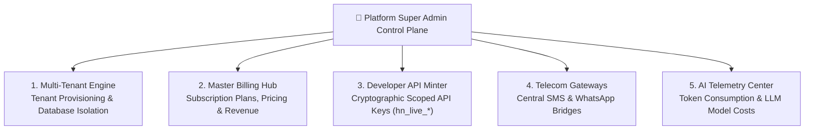

# Platform Super Admin Control Plane Overview & Architecture

The **Platform Super Admin** (`/super-admin/*`) is the highest authority in the HubNest and HubCRM ecosystem. While regular Company Admins manage their own single company workspace, the Super Admin operates the overarching multi-tenant platform infrastructure — provisioning new customer organizations, monitoring server health, issuing developer API keys, and managing global billing.

{ width="90" }

---

## 👑 What Does the Platform Super Admin Do?

The Super Admin Control Plane provides master tools to operate HubCRM as a software-as-a-service (SaaS) business:

* 🏢 **Multi-Tenant Organization Management**: Provision new client companies, set database quotas, and handle account deactivations.
* 💳 **Master Billing & Plan Tiers**: Create subscription plans (Starter, Professional, Enterprise), set seat pricing, and view global platform revenue.
* 🔑 **Developer API Key Engine**: Generate secure scoped API tokens (`hn_live_*`) for enterprise clients integrating external systems.
* 📱 **Central SMS & Communication Gateways**: Manage global SMS provider routes (Fast2SMS / Twilio) and monitor telecom delivery health.
* 🤖 **AI Model Telemetry & Cost Controls**: Audit OpenAI/Anthropic/Gemini token consumption, monitor vector latency, and prevent cost overruns.
* 🖥️ **System Health & Security Auditing**: Track real-time server latencies, database connection pools, and platform-wide error logs.

---

## 🧭 The Super Admin Platform Architecture

---

## 🖥️ Screen Tour: Super Admin Navigation

When you log into HubCRM with a Super Admin profile, your dashboard provides multi-tenant controls:

| Super Admin Menu Item | Icon | What You Do Here |
| :--- | :--- | :--- |
| **Global Dashboard** | 📊 | Platform-wide snapshot: total active tenants, aggregate ARR/MRR revenue, and server health. |
| **Tenant Directory** | 🏢 | List of all onboarded client companies, active subscription status, and seat limits. |
| **Global Subscription Plans**| 💳 | Create, edit, and price software plans (Starter, Professional, Enterprise). |
| **Platform Administrators** | 🛡️ | Manage root super admin accounts and grant delegated support access. |
| **Developer API Keys** | 🔑 | Issue and revoke secure external API keys (`hn_live_*`) for enterprise developers. |
| **SMS Gateway Settings** | 📱 | Configure master telecom routes, SMS sender IDs, and test gateway connectivity. |
| **AI Telemetry & Costs** | 🤖 | Monitor token consumption across all tenants, query latencies, and AI assistant health. |
| **System Health & Logs** | 🖥️ | Real-time database connection pooling stats, error logs, and infrastructure monitoring. |

---

## 📚 What's in this Super Admin Manual?

Follow these step-by-step guides to master your platform administration tasks:

1. [Tenant Provisioning & Lifecycle](tenants.md): Onboarding client organizations and managing storage quotas.
2. [Global Plans & Subscription Pricing](billing-plans.md): Creating subscription tiers and managing revenue.
3. [Platform Admins & Delegated Access](admins-rbac.md): Managing root administrator accounts.
4. [Developer API Keys (`hn_live_*)](api-management.md): Minting and revoking scoped developer tokens.
5. [Central SMS Gateway Configuration](sms-gateway.md): Configuring Fast2SMS and delivery routes.
6. [AI Telemetry & Model Costs](ai-telemetry.md): Tracking LLM token usage and cost controls.
7. [System Health & Infrastructure Auditing](audit-system.md): Monitoring platform telemetry and error logs.
8. [Root Security & Hardware MFA](profile-security.md): Securing Super Admin credentials with hardware keys.
