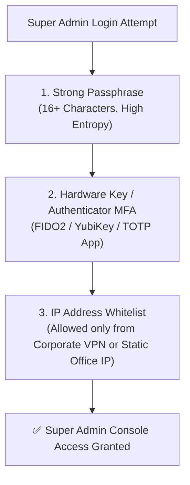

# Root Administrator Security & Hardware MFA Guide

Because Platform Super Admins possess master authority over all customer databases, billing portals, and API keys, securing super administrator credentials is the single most critical security obligation for your organization.

The **Security Settings Center** (`/super-admin/profile`) provides enterprise-grade protection tools to prevent account takeovers.

---

## 🛡️ Multi-Layered Super Admin Protection

---

## 🔑 Setting Up Multi-Factor Authentication (MFA)

SMS text messages can occasionally be vulnerable to SIM-swap attacks. For Super Admin accounts, HubCRM recommends **Hardware Security Keys (FIDO2)** or **Authenticator Apps (TOTP)**:

1. In your Super Admin Profile, click **Security Settings ➔ Enable MFA**.
2. **Option A: Physical Security Key (Recommended):**
   * Insert your **YubiKey** or hardware security key into your computer's USB port.
   * Tap the gold contact to register the cryptographic key with your browser.
3. **Option B: Authenticator App:**
   * Scan the on-screen QR code with **Google Authenticator** or **1Password**.
   * Enter the 6-digit rolling code to confirm synchronization.

---

## 🖨️ Emergency Backup Recovery Codes

When you activate MFA, HubCRM generates **10 Single-Use Backup Emergency Codes**:

* **What They Are For:** If your phone is lost, broken, or stolen, these codes allow emergency access to your platform account.
* **Storage Protocol:** Print these codes or save them on an encrypted offline USB drive stored in a physical office safe. **Never store them in plain-text online notes!**

---

## 🔒 Session Security & Inactivity Timeouts

* **15-Minute Inactivity Auto-Lock:** If you step away from your desk for more than 15 minutes, HubCRM automatically locks the screen and prompts for your PIN or password before displaying sensitive customer data.
* **1-Click Terminate All Sessions:** If you suspect an unauthorized browser session is active, click **Revoke All Active Sessions** to instantly log out every device across the globe.
