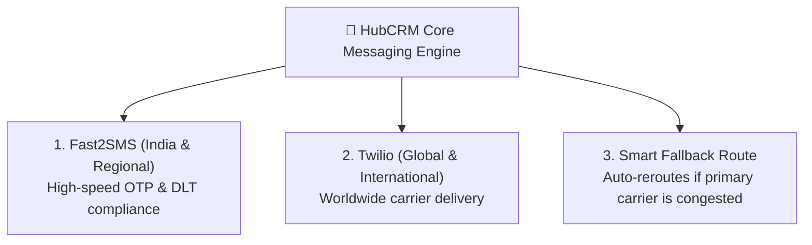

# Central SMS Gateway Configuration & Telephony Health Guide

SMS text messaging is essential for OTP authentication codes, password resets, meeting notifications, and promotional marketing broadcasts. The **SMS Gateway Center** (`/super-admin/sms/settings`) is where Super Admins configure master telecom provider credentials, check credit balances, and monitor delivery health across all tenants.

---

## 📱 Supported Global SMS Providers

HubCRM includes native adapters for the world's most reliable telecom providers:

---

## ⚙️ How to Configure Fast2SMS in 3 Steps

1. Navigate to **Super Admin ➔ SMS Gateway Settings**.
2. Select **Fast2SMS** as your active primary provider.
3. Fill in your master credentials:
   * **API Authorization Key:** Paste your secure Fast2SMS token.
   * **Route Type:** Select `OTP / Transactional` for time-sensitive verification codes, or `Promotional` for marketing blasts.
   * **Sender ID:** Your registered DLT header (e.g., `HBNEST`).
4. Click **Save Settings**.

---

## 🧪 Testing Gateway Connectivity

Before enabling telecom broadcasting for all customer tenants:

1. In the **Test Gateway** widget on the right side of the screen:
2. Enter your personal mobile phone number (with country code).
3. Type a sample message (e.g., *"HubNest SMS Gateway Health Check: OK"*).
4. Click **Send Test SMS**.
5. Check your mobile phone. The message should arrive within 3 to 5 seconds! The test log displays the carrier transaction ID and round-trip latency.

---

## 📊 Monitoring Telecom Health & Balance Alerts

* **Delivery Success Rate:** Tracks the percentage of SMS messages delivered successfully to handsets (healthy systems maintain **>98%**).
* **Credit Balance Gauge:** Displays your remaining SMS wallet credits.
* **Low-Balance Automated Alert:** Set a safety threshold (for example, *Send alert when balance drops below 5,000 credits*). HubCRM will notify platform administrators to top up the wallet before customer OTPs are impacted!
