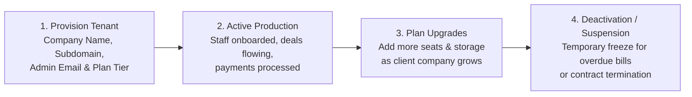

# Tenant Organization Provisioning & Lifecycle Guide

In multi-tenant cloud software, each client organization is called a **Tenant**. Every tenant possesses its own completely isolated database partition, users, customer records, and custom settings. 

The **Tenant Management Center** (`/super-admin/tenants`) is where Super Admins onboard new enterprise clients, allocate seat quotas, and manage account lifecycles.

---

## 🏢 The Tenant Lifecycle

---

## ➕ How to Provision a New Tenant in 4 Steps

When your sales team closes a new enterprise corporate contract:

1. Go to **Super Admin ➔ Tenants** and click **+ Provision New Tenant**.
2. **Organization Information:**
   * **Company Name:** Legal business name (e.g., *"Apex Logistics Private Limited"*).
   * **Workspace Slug / Domain:** Subdomain identifier (e.g., `apexlogistics`). The client will access their portal at `https://apexlogistics.crm.srjhubnest.com` or via central login.
   * **Industry & Region:** e.g., *Logistics / India (Mumbai)*.
3. **Plan & Resource Allocation:**
   * **Subscription Tier:** Select *Starter, Professional,* or *Enterprise*.
   * **Licensed User Seats:** Enter the contracted seat count (e.g., *50 Seats*).
   * **Document Storage Quota:** e.g., *100 GB Cloud Storage*.
4. **Primary Administrator Account:**
   * Enter the client's Chief Technology Officer or IT Director's work email and full name.
5. Click **Provision Tenant Workspace**.

### What Happens Instantly Behind the Scenes:
* HubCRM initializes the dedicated tenant database partition with standard tables.
* A welcome email with a secure setup link is dispatched to the client's primary administrator.
* The tenant organization immediately shows as **🟢 Active** on your global dashboard!

---

## ⏸️ Suspending or Deactivating a Tenant

If a client cancels their annual subscription or is over 60 days overdue on payments:

1. Locate the company in the Tenant Directory.
2. Click **Manage Tenant** and select **Suspend Workspace**:
   * **Suspended Status:** User logins are temporarily blocked with a polite payment notification screen.
   * **Data Remains 100% Intact:** No records are erased. If the client clears their invoice, you can reactivate their workspace in 1 click!
3. **Permanent Deletion:** Only performed upon written client request after the statutory 90-day retention holding period.
