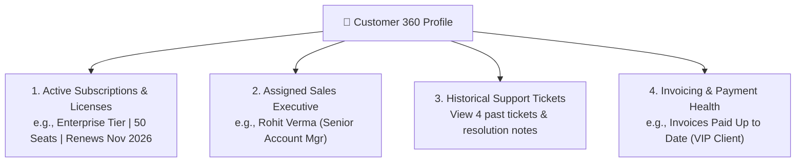

# Customer 360 History & Relationship Context Guide

Nothing frustrates a customer more than having to repeat their account number, plan details, and past complaints to three different support agents.

In HubCRM, when you open any ticket, the **Customer 360 Panel** (`/support/customers/:id`) automatically displays the client's complete relationship history on the left side of your screen.

---

## 🔍 What You See in the Customer 360 View

---

## 💡 How Customer Context Helps You Solve Problems Faster

### 1. Knowing Their Exact Plan & Features
* If a customer asks: *"Why can't I access AI Copywriting Studio?"*
* You look at the Customer 360 card and immediately see: *"They are on the Starter Plan, which does not include AI Studio."*
* Instead of debugging technical logs for 20 minutes, you can explain politely:  
  > *"Hello Priya, your current Starter Plan includes our core CRM pipelines. AI Copywriting is an Enterprise feature. I would be happy to connect you with your account manager Rohit if you'd like a free trial!"*

### 2. Checking Past Support Tickets
* Before answering, glance at the **Past Tickets** tab.
* If you notice they opened a similar ticket two weeks ago for camera permissions:
  * You know this is a recurring issue.
  * You can provide a permanent fix or offer to jump on a quick 5-minute HubMeet video call to fix their browser settings directly!

### 3. Spotting High-Value Strategic Clients (VIPs)
* If an account is tagged **Enterprise VIP** and has an active deal renewing next week, you know this client requires extra care and rapid response. You can flag the assigned sales rep so they stay updated on customer happiness!
