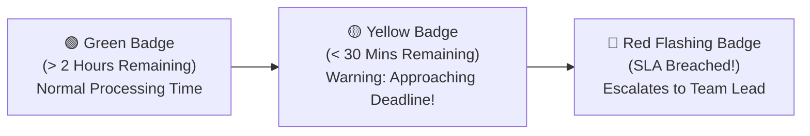

# Support Dashboard, Queue & SLA Timers Guide

When dozens of customers need assistance simultaneously, knowing which ticket to open first is critical. The **Support Dashboard** (`/support/dashboard`) organizes all inbound issues into a smart, prioritized queue so you always address urgent client problems before deadlines expire.

---

## 📊 Core Support Summary Widgets

At the top of your support console, four real-time cards show your daily workload:

| Dashboard Card | What It Shows | Support Agent Action |
| :--- | :--- | :--- |
| **Open Queue Volume** | Total unresolved tickets across the entire support department. | Helps balance team support load. |
| **Assigned to Me** | The exact number of customer issues currently waiting on your desk. | **Your primary daily task list.** Aim to clear these before the end of your shift. |
| **Urgent Priority** | Critical service outages or high-value VIP customer complaints. | **Drop everything and address these first!** |
| **Average Response Time** | Average minutes taken by you to send the first reply to a new ticket (e.g., *14 mins*). | Fast responses directly drive high customer satisfaction ratings. |

---

## ⏱️ The SLA Countdown Timer

Every ticket in HubCRM features a dynamic **Service Level Agreement (SLA) Countdown Timer**:

* **First Response SLA:** The maximum promised time to send the initial acknowledgment (usually *1 hour* for standard tickets, *15 minutes* for urgent ones).
* **Resolution SLA:** The total target time to solve the problem and close the ticket (e.g., *24 hours*).
* **Sort by SLA:** Click the **SLA column header** to sort your queue with the most urgent expiring tickets pinned right at the very top of your screen!

---

## 📋 Understanding Ticket Priority Levels

Tickets are color-coded into four standard tiers:

* **Urgent (🔴):** System down, data unreachable, or entire team unable to work. (Requires immediate phone or video call).
* **High (🟠):** Major feature broken, but workaround exists.
* **Medium (🟡):** General technical question, user permission change, or setup guidance.
* **Low (🔵):** Minor cosmetic bug, feature request, or general feedback.
