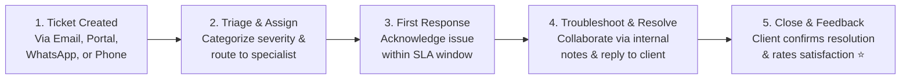

# Customer Support Agent Overview & Helpdesk Guide

Winning a new customer is only the start of the customer journey — keeping them happy, solving technical issues quickly, and maintaining high satisfaction is what drives renewals and referrals. As a **Customer Support Agent**, you are the everyday face and voice of your company.

HubCRM's **Support & Helpdesk Hub** (`/support/*`) provides an omnichannel inbox where customer tickets from email, chat, and phone calls are organized with automated SLA tracking so no client inquiry is ever ignored.

{ width="90" }

---

## 🎯 What Does HubCRM Do for Support Teams?

HubCRM takes the stress and chaos out of customer issue resolution:

* 🚫 **No More Lost Customer Inquiries**: Every email sent to your support inbox or issue logged via chat automatically turns into a tracked, numbered ticket.
* 🚫 **No More SLA Breaches**: Visual countdown timers alert you when a customer ticket is approaching its promised response or resolution deadline.
* 🚫 **Full Customer Context**: See the customer's active deals, purchased products, and previous support tickets on a single screen without asking repetitive questions.
* 🚫 **Self-Service Knowledge Base**: Turn common customer questions into instant public help articles so clients can solve problems themselves 24/7.

---

## 🧭 The Support Ticket Resolution Lifecycle

---

## 🖥️ Screen Tour: Support Navigation

When you log into HubCRM with a Support profile, your sidebar reveals dedicated helpdesk tools:

| Support Menu Item | Icon | What You Do Here |
| :--- | :--- | :--- |
| **Support Dashboard** | 📊 | Real-time queue: open tickets, SLA countdowns, and your personal daily resolution count. |
| **Ticket Queue** | 🎫 | All customer issues organized by status (*New, In Progress, Waiting on Customer, Resolved*). |
| **Customers 360** | 👥 | Customer directory showing client profiles, active software licenses, and purchase history. |
| **Knowledge Base (KB)**| 📚 | Library of self-service troubleshooting guides and public FAQs. |
| **Internal Chat** | 💬 | Private team chat to consult with product engineers or senior technical leads. |
| **My Support Profile** | ⭐ | Track your personal First Response Time (FRT), customer rating score, and active assignments. |

---

## 📚 What's in this Support Manual?

Follow these step-by-step guides to master your support workflows in HubCRM:

1. [Support Dashboard & SLA Timers](dashboard.md): Monitor queue volumes, urgent alerts, and response timers.
2. [Managing Tickets & Customer Replies](ticket-management.md): Step-by-step walkthrough of handling and resolving issues.
3. [Tier-2 Escalations & Specialist Handoff](ticket-escalation.md): When and how to escalate technical bugs to senior engineers.
4. [Knowledge Base Authoring](knowledge-base.md): Creating helpful step-by-step FAQs and troubleshooting articles.
5. [Customer 360 History](customer-history.md): Checking customer purchase history and past conversations.
6. [Agent Assignment & Performance](profile-sla.md): Managing your ticket workload and tracking satisfaction scores.
