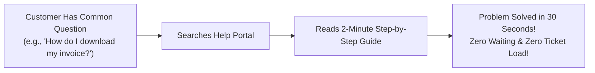

# Knowledge Base Authoring & Help Articles Guide

The best support experience is when a customer can find a crystal-clear answer in 30 seconds without having to wait in a support queue. HubCRM's **Knowledge Base (KB)** (`/support/knowledge-base`) allows support teams to publish searchable, self-service help articles that resolve common questions automatically 24/7.

---

## 📚 Why Building a Knowledge Base Matters

* **Instant Customer Satisfaction:** Clients love finding answers instantly on their own time.
* **Reduces Repetitive Ticket Volume:** Publishing articles for the top 10 common questions typically cuts your daily ticket queue by **30% to 50%**!

---

## ✍️ How to Author a New Help Article in 4 Steps

1. Navigate to **Support ➔ Knowledge Base** and click **+ New Article**.

### Step 1: Write an Action-Oriented Title
Use the exact phrases customers type into search bars:
* ✅ **Good:** *"How to Change Your Account Password via Mobile OTP"*
* ✅ **Good:** *"Step-by-Step: Exporting Employee Attendance to Excel"*
* ❌ *Avoid:* *"Password Module Overview"* (Too vague)

### Step 2: Choose the Correct Help Category
Organize your article into an intuitive folder:
* **Getting Started & Login:** Account activation, browser setup, desktop app download.
* **Workspace & Features:** Meeting scheduling, CRM pipelines, attendance check-in.
* **Billing & Invoices:** Payment options, downloading receipts, updating GST numbers.
* **Troubleshooting & FAQs:** Resolving camera permissions, clearing cache, login errors.

### Step 3: Write Clear, Jargon-Free Steps
Follow the proven 3-part layout:
1. **The Goal:** Explain in one sentence what this guide accomplishes.
2. **Numbered Steps:** Break instructions down into simple clicks:
   * *Step 1: Click on Settings in the top-right corner.*
   * *Step 2: Select 'My Profile' and click 'Change Password'.*
   * *Step 3: Enter your 6-digit OTP received via SMS.*
3. **Tips & Warnings:** Use visual notes to highlight common mistakes.

### Step 4: Add Search Keywords & Publish
* In the **Search Tags** box, type common synonyms (e.g., `password`, `reset`, `forgot`, `login`, `otp`).
* Click **Publish Article**. The guide is immediately searchable on your public help portal!

---

## ⚡ Inserting KB Articles into Ticket Replies

When answering a customer ticket:
1. In your reply box, click **Insert KB Article (📖)**.
2. Search for the relevant article (e.g., *"Download Invoice"*).
3. HubCRM inserts a polite message with the direct link:  
   > *"Hello Rajesh, here is our quick 2-minute visual guide that walks you through downloading your invoice: [Link: How to Download Invoices]"*
4. Your ticket is answered in seconds with complete, visual clarity!
