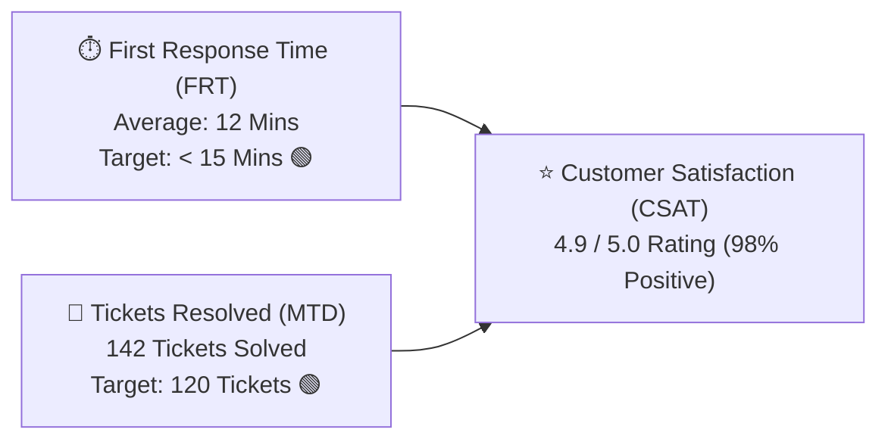

# Support Agent Profile, Status & CSAT Performance Guide

Delivering great customer support is a rewarding career. In HubCRM, you have full transparency into your personal performance metrics, response times, and customer compliments through the **Agent Profile & Performance Center** (`/support/profile`).

---

## 🟢 Managing Your Availability Status

To ensure tickets are only routed to you when you are actively seated at your computer, keep your **Status Toggle** updated in the top-right navigation bar:

| Status | Icon | What It Means to the System |
| :--- | :--- | :--- |
| **Available** | 🟢 | You are at your desk and ready to accept new customer tickets and live chats. |
| **Busy** | 🟡 | You are working on a complex investigation; new ticket routing is temporarily slowed down. |
| **Away / Lunch** | ☕ | You are on a break; incoming tickets bypass you and route to active teammates. |
| **Offline** | ⚪ | Your shift is finished. Ticket auto-routing is completely paused. |

---

## 🏆 Key Performance Metrics (CSAT & FRT)

Your personal dashboard tracks three primary performance benchmarks:

### 1. First Response Time (FRT)
* The average minutes between a customer submitting a ticket and you sending your first human reply.
* Keeping FRT under **15 minutes** prevents customer frustration and builds immediate confidence.

### 2. Customer Satisfaction Score (CSAT)
* When you close a ticket, the customer receives a 1-tap rating survey:
  * ⭐⭐⭐⭐⭐ *"Fantastic, solved in 5 minutes!"*
  * ⭐⭐⭐⭐ *"Good resolution."*
  * ⭐ *"Slow response."*
* Your profile shows your positive rating percentage (aim for **90%+**).

### 3. Customer Compliments Vault
* When a customer leaves an enthusiastic comment praising your help, it is saved in your **Compliments Vault**! You can showcase these during quarterly performance appraisals and bonus reviews.

---

## 🔔 Notification & Audio Alerts

Never miss an urgent ticket:
* **Audio Chime:** Turn on the gentle chime alert so you hear a sound when an urgent ticket lands in your queue.
* **Browser Push Notifications:** Receive a desktop popup even if HubCRM is minimized behind other application windows.
