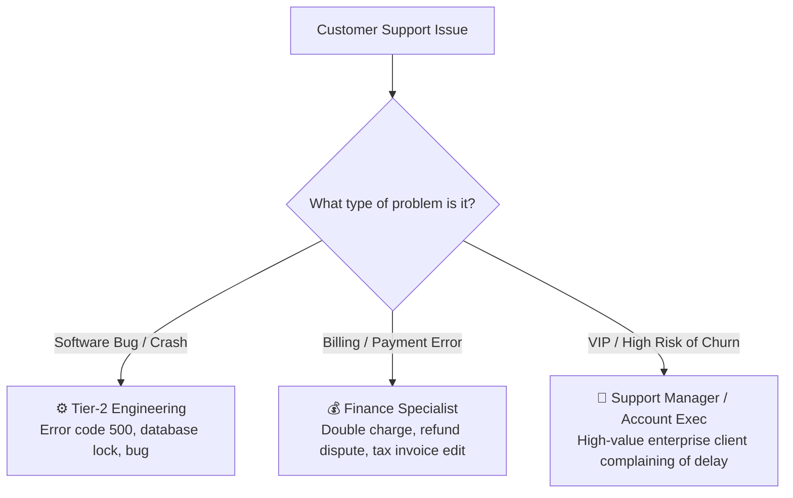

# Ticket Escalation & Senior Specialist Handoff Guide

Frontline support agents can solve over 80% of standard questions like password resets, feature navigation, and account settings. However, when a customer encounters a technical software bug, a payment gateway error, or a severe service outage, escalating to the right specialist quickly is essential.

HubCRM's **Ticket Escalation Workflow** (`/support/tickets/:id/escalate`) ensures smooth handoffs without the customer having to re-explain their problem to three different people.

---

## 🚨 When Should You Escalate a Ticket?

Escalate immediately if you encounter any of the following scenarios:

---

## 🚀 How to Escalate in 3 Simple Steps

1. Inside the ticket, click the **Escalate Ticket (🚨)** button in the top-right corner.
2. Select the **Escalation Department**:
   * **Tier-2 Technical / Engineering:** For reproducible bugs, API failures, or database errors.
   * **Finance & Invoicing:** For credit card payment failures, refund requests, or GST amendments.
   * **Senior Support Manager:** For urgent escalations and VIP relationship handling.
3. Fill in the **Escalation Handoff Brief**:
   * **Summary of Problem:** e.g., *"Customer getting error 'User Already Exists' when creating branch employee."*
   * **Steps Already Taken:** e.g., *"Verified user permissions; cleared browser cache; error still persists."*
   * **Impact / Severity:** e.g., *Customer has 45 employees waiting to log in today.*
4. Click **Confirm Escalation**.

---

## 🤝 What Happens After You Escalate?

* **Ownership Transferred:** The ticket is automatically reassigned to the Tier-2 team queue.
* **Instant Team Alert:** The assigned engineering lead receives a high-priority notification with your brief attached.
* **Customer Status Update:** An automated polite update informs the customer:  
  > *"Your ticket has been escalated to our Senior Engineering Team. Specialist Rohit is actively investigating the logs and will follow up shortly."*
* **You Stay in the Loop:** You remain subscribed as a **Watcher** on the ticket so you can see how the technical issue was solved and build your personal technical knowledge for the future!
