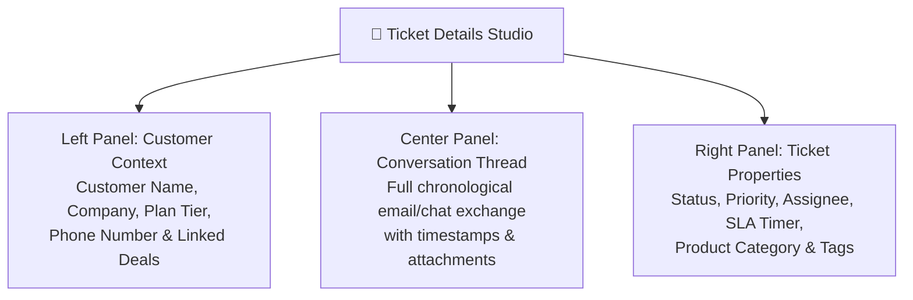

# Ticket Handling, Conversations & Internal Notes Guide

When you click on any ticket in your queue (`/support/tickets/:id`), HubCRM opens the **Unified Conversation Studio**. This screen brings together the customer's message history, account details, and private team collaboration tools so you can solve problems quickly without switching tabs.

---

## 🖥️ Screen Layout of a Ticket

---

## 💬 Public Reply vs. 🔒 Internal Private Note

At the bottom of the conversation thread, you will see two tabs:

### 1. Public Customer Reply (Blue Button)
* **Who Sees This:** Sent directly to the customer via email, portal notification, or WhatsApp.
* **Best Used For:** Answering customer questions, sharing resolution steps, or asking for more details.
* **Formatting Options:** Add bold text, bullet points, step-by-step numbers, and attach screenshots or PDF guides.

### 2. Internal Private Note (Yellow Background 🔒)
* **Who Sees This:** **Strictly invisible to the customer.** Only your internal teammates, managers, and software engineers can read this.
* **Best Used For:** Collaborating behind the scenes:
  * *"Tagging @developer-suresh: Can you check database logs for why this user's password reset token failed?"*
  * *"FYI: Customer was slightly frustrated on the phone; handle with extra care."*

---

## ⚡ Using Canned Responses (Saved Quick Replies)

Tired of typing the exact same troubleshooting steps ten times a day?

1. Inside the reply box, click the **Canned Response (⚡)** icon.
2. Select from approved standard answers:
   * *Clear Browser Cache & Cookies*
   * *How to Reset Password via OTP*
   * *Where to Download GST Invoice*
   * *Feature Request Acknowledgment*
3. The template automatically inserts the customer's name (e.g., *"Hello Rajesh"*).
4. Review, customize if needed, and click **Send Reply**.

---

## 🏷️ Setting the Correct Ticket Status

Always update the **Status** dropdown after every interaction:

| Status | Meaning | What It Does to SLA Timers |
| :--- | :--- | :--- |
| **New** | Just arrived; unread by any agent. | SLA First Response Timer is actively ticking down! |
| **In Progress** | Agent has opened and is actively investigating the problem. | First response SLA stops; Resolution timer continues. |
| **Waiting on Customer** | You asked the customer for a screenshot or account ID. | **Pauses the SLA timer!** You are not penalized while waiting for the client to reply. |
| **Resolved** | You have provided the solution. | Solved! Customer receives an automated confirmation asking if everything is working. |
| **Closed** | Customer confirms all is good, or ticket auto-closes 48 hours after resolution. | Finalized. Triggers customer satisfaction (CSAT) rating! |
