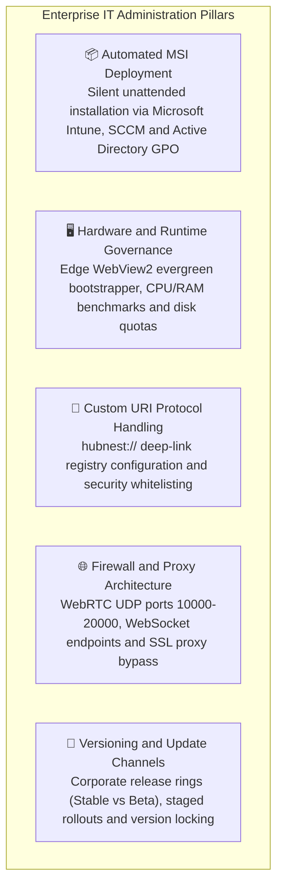
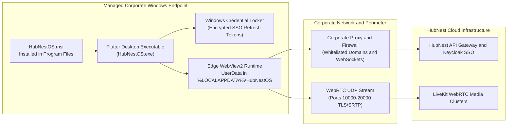
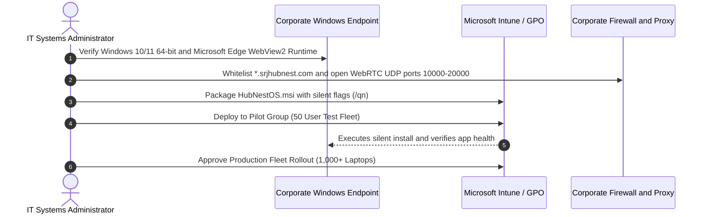

# IT Administrator & Enterprise Desktop Deployment Overview

Welcome to the **HubNest OS IT Administrator & Enterprise Deployment Guide**. As an enterprise systems engineer, desktop administrator, or IT operations lead, you are responsible for provisioning, securing, and maintaining the HubNest OS desktop client across hundreds or thousands of corporate endpoints.

HubNest OS is engineered with enterprise IT standards at its foundation: it ships as a signed **Windows Installer (`HubNestOS.msi`)**, supports silent unattended deployment via **Microsoft Intune** and **Active Directory Group Policy (GPO)**, utilizes the enterprise-standard **Microsoft Edge WebView2 Runtime**, and complies with corporate proxy and firewall policies.

---

## 1. Enterprise IT Management Pillars

- **Silent Unattended Deployment:** Deploy `HubNestOS.msi` silently across managed fleets using standard command-line parameters (`msiexec /i HubNestOS.msi /qn /norestart`) without requiring end-user interaction.
- **Modern Management via Microsoft Intune:** Package HubNest OS as an enterprise `.intunewin` or line-of-business (LOB) application with automated compliance and health detection rules.
- **Enterprise Web Isolation:** Leverage Microsoft Edge WebView2's security sandbox, process isolation, and hardware-accelerated video pipelines.
- **Secure Custom Protocol Handling (`hubnest://`):** Register the custom deep-linking protocol in the Windows registry so employees can launch video calls or trigger telephone dialers directly from intranet links or emails.
- **Firewall & Corporate Proxy Compliance:** Ensure crystal-clear VoIP and WebRTC streaming by configuring corporate firewalls to permit UDP voice traffic and bypass SSL inspection on WebSocket endpoints.

---

## 2. Desktop Architecture & IT Security Model

---

## 3. IT Administrator Pre-Deployment Checklist

Before initiating a company-wide rollout across employee laptops, verify the following prerequisites:

### 1. Endpoint OS Verification:
Confirm that target machines run Windows 10 64-bit (Version 1903+) or Windows 11 with the latest cumulative security updates.

### 2. Runtime Dependency Check:
Ensure the Microsoft Edge WebView2 Evergreen Runtime is installed. *(On Windows 11 and modern Windows 10 updates, WebView2 is pre-installed as part of the operating system).*

### 3. Network & Proxy Exceptions:
Confirm that your corporate perimeter firewalls allow outbound HTTPS (`443`) and WebSockets (`wss://`) to `*.srjhubnest.com`, and permit UDP traffic on ports `10000–20000` for real-time video/audio.

---

## 4. Next Steps in this Guide

Explore each administrative guide to execute your enterprise deployment:

- 📦 **[MSI Enterprise Deployment & Intune Rollout](msi-enterprise-deployment.md):** Silent command-line flags, Intune packaging, and Active Directory GPO distribution.
- 🖥️ **[System Requirements & Edge WebView2](system-requirements-webview2.md):** Minimum hardware specs, RAM constraints, and WebView2 bootstrapper validation.
- 🔗 **[Protocol Handlers & Deep Linking (`hubnest://`)](protocol-deep-linking.md):** Registering custom URI schemes and deep link security.
- 🌐 **[Network, Proxy & Firewall Configuration](network-proxy-updates.md):** Domain whitelisting, WebRTC ports, corporate proxy bypass, and auto-update rings.
