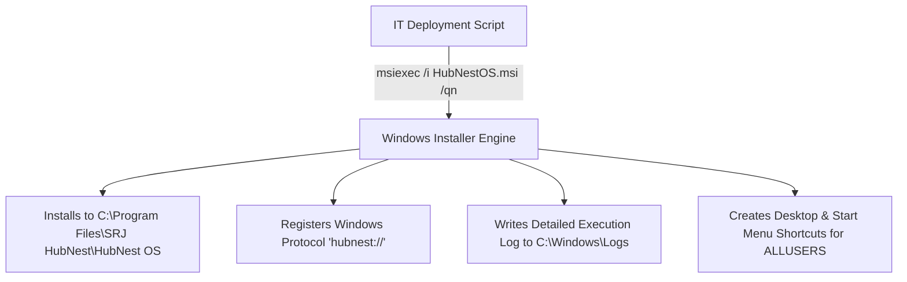
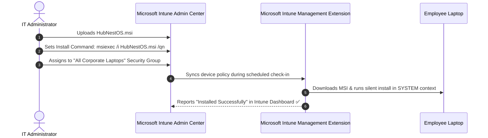
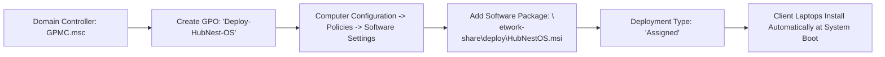

# Enterprise MSI Deployment & Intune Rollout

For organizations managing hundreds or thousands of corporate laptops, manual installation is out of the question. HubNest OS ships as a professionally compiled, signed **Windows Installer (`HubNestOS.msi`)** built using the open-source **WiX Toolset**.

This guide covers silent unattended installation command lines, enterprise packaging via **Microsoft Intune**, and fleet distribution using **Active Directory Group Policy (GPO)**.

---

## 1. Silent Command-Line Installation (MSIEXEC)

You can install, upgrade, or uninstall HubNest OS silently via PowerShell, Command Prompt, or remote deployment scripts without displaying any visual GUI prompts to the end-user:



### Standard Silent Installation Command:
```cmd
msiexec.exe /i "HubNestOS.msi" /qn /norestart /l*v "C:\Windows\Logs\HubNestOS_Install.log"
```

### Parameter Breakdown:
- `/i "HubNestOS.msi"`: Tells the Windows Installer service to execute an installation.
- `/qn`: **Quiet No-UI Mode** (completely hides all wizard dialogs, progress bars, and prompts).
- `/norestart`: Prevents the computer from automatically rebooting after installation finishes.
- `/l*v "C:\Windows\Logs\HubNestOS_Install.log"`: Generates a verbose technical log for verification and audit troubleshooting.
- `ALLUSERS=1` (Optional): Forces a per-machine installation so every Windows user profile on the computer has access.

### Silent Uninstallation Command:
```cmd
msiexec.exe /x "HubNestOS.msi" /qn /norestart /l*v "C:\Windows\Logs\HubNestOS_Uninstall.log"
```

---

## 2. Deploying via Microsoft Intune (Endpoint Manager)

Microsoft Intune is the preferred cloud management platform for modern hybrid and remote workforces. You can deploy HubNest OS as a **Line-of-Business (LOB) App** or as an advanced **Win32 App (`.intunewin`)**:



### Step-by-Step Intune Packaging:
1. Sign in to the **Microsoft Intune Admin Center** (`endpoint.microsoft.com`).
2. Navigate to **Apps** $\rightarrow$ **Windows** $\rightarrow$ **Add**.
3. Under **App Type**, select **Line-of-business app** (or *Windows app (Win32)*).
4. Click **Select app package file** and upload `HubNestOS.msi`.
5. Intune automatically extracts:
   - **Name:** HubNest OS
   - **Publisher:** SRJ HubNest Enterprise
   - **App Version:** e.g., `1.7.0`
   - **Context:** Device (Per-Machine)
6. Under **Command-line arguments**, enter:
   `/qn /norestart`
7. In the **Assignments** tab, assign the app as **Required** to your target Azure AD device groups (e.g., *"All Windows 11 Corporate Endpoints"*).
8. Click **Create**. Intune will silently install HubNest OS on all targeted laptops during their next synchronization cycle.

---

## 3. Detection & Health Rules for Win32 Apps

If you choose to package the MSI into an `.intunewin` container using the Microsoft Win32 Content Prep Tool (`IntuneWinAppUtil.exe`):

### Installation Command:
`msiexec /i "HubNestOS.msi" /qn /norestart`

### Uninstall Command:
`msiexec /x "{YOUR_PRODUCT_CODE_GUID}" /qn /norestart`

### Detection Rules (Use File or Registry Rule):
- **Rule Type:** File
- **Path:** `C:\Program Files\SRJ HubNest\HubNest OS`
- **File or Folder:** `HubNestOS.exe`
- **Detection Method:** File or folder exists *(or String (version) greater than or equal to `1.7.0.0`)*.

---

## 4. Deploying via Active Directory Group Policy (GPO)

For traditional on-premise Active Directory domain environments:



1. Place `HubNestOS.msi` into a shared network distribution folder accessible by domain computers (e.g., `\\dc01\software$\HubNest\HubNestOS.msi`).
2. Open **Group Policy Management Console (`gpmc.msc`)** on your Domain Controller.
3. Create a new GPO: *"Software Deployment - HubNest OS"*.
4. Navigate to **Computer Configuration** $\rightarrow$ **Policies** $\rightarrow$ **Software Settings** $\rightarrow$ **Software installation**.
5. Right-click $\rightarrow$ **New** $\rightarrow$ **Package**.
6. Select the network UNC path of `HubNestOS.msi`.
7. Choose **Assigned** as the deployment method.
8. Click **OK**.
9. The next time domain computers restart or run `gpupdate /force`, HubNest OS installs silently before the Windows login screen appears.
