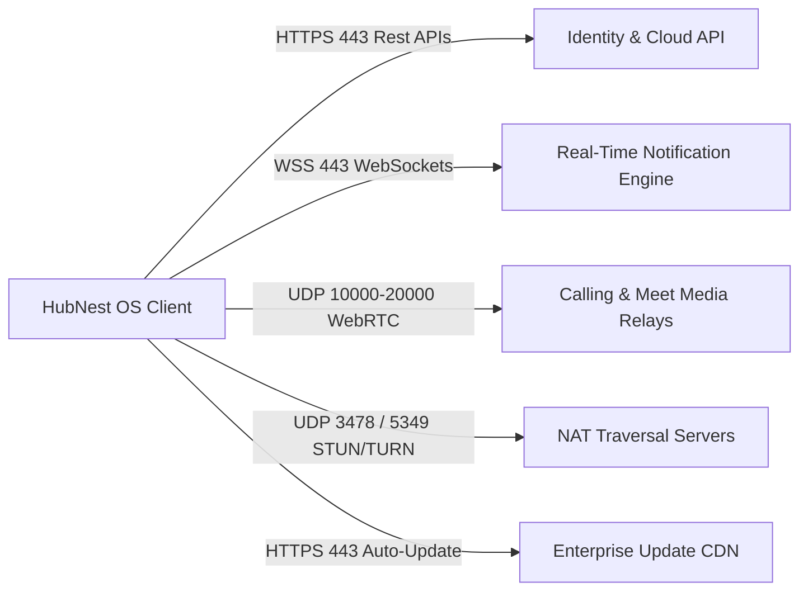
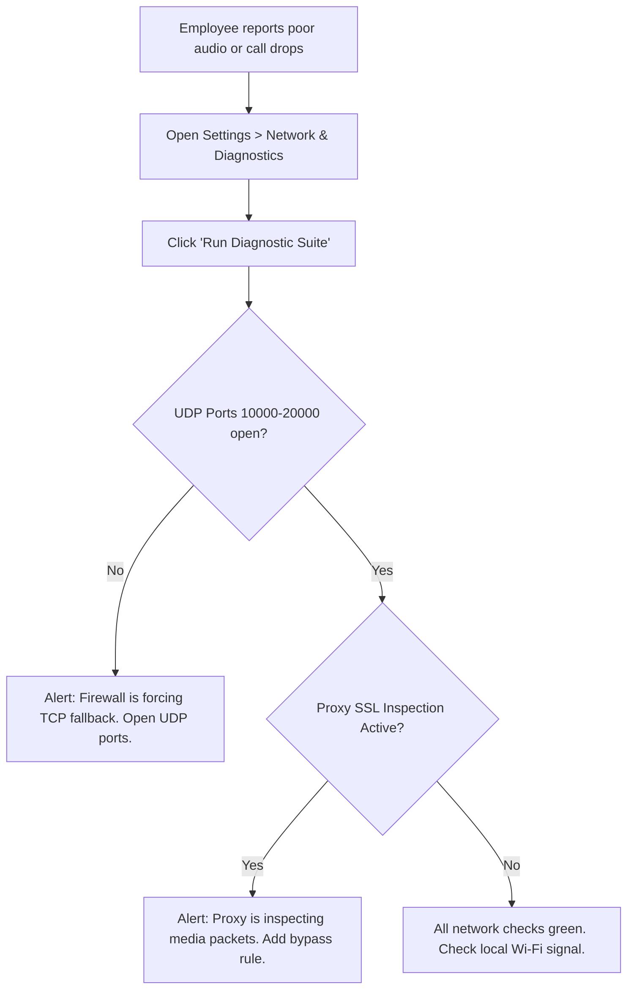

# Network Configuration, Proxies & Update Management

Welcome to the **HubNest OS Network, Proxy & Auto-Update Guide**. As an IT Administrator, ensuring dependable network connectivity, low-latency audio/video communication, and disciplined software version control is essential to enterprise productivity.

HubNest OS combines standard HTTPS/WebSocket API traffic with real-time WebRTC media streams (for Calling Hub and HubMeet) and automatic software updates. This guide outlines the required firewall rules, domain whitelisting, corporate proxy settings, and update channel deployment strategies.

---

## 1. Network Architecture Overview

HubNest OS establishes three distinct categories of network communication:



1. **Control Plane (Port 443 HTTPS):** User authentication, workspace configuration, CRM record retrieval, HRMS forms, and system telemetry.
2. **Real-Time Data Plane (Port 443 WSS):** WebSocket channels for instantaneous incoming call alerts, presence indicators, and live chat notifications.
3. **Media Plane (UDP 10000–20000 & STUN/TURN):** Low-latency encrypted RTP audio and video packets for crystal-clear Calling Hub voice calls and multi-party HubMeet conferences.
4. **Update Plane (HTTPS 443):** Background signature checks, delta patch downloads, and enterprise installer delivery.

---

## 2. Firewall Port & Protocol Requirements

Ensure your perimeter firewalls, network switches, and host-based Windows Defender Firewalls permit the following outbound ports:

| Service / Purpose | Protocol | Port Range | Destination Target | Direction | Requirement Level |
| :--- | :--- | :--- | :--- | :--- | :--- |
| **API & Web Views** | TCP | `443` | `*.hubnest.com` | Outbound | **Mandatory** |
| **Real-Time WebSockets** | TCP | `443` (WSS) | `ws.hubnest.com` | Outbound | **Mandatory** |
| **STUN NAT Discovery** | UDP | `3478` | `stun.hubnest.com` | Outbound | **Mandatory** for Voice/Video |
| **TURN Media Relay (Fallback)** | TCP / UDP | `3478`, `5349` (TLS) | `turn.hubnest.com` | Outbound | Highly Recommended |
| **Direct WebRTC Media (RTP/SRTP)** | UDP | `10000 - 20000` | Media Relays / Gateways | Outbound / Inbound (Stateful) | **Mandatory** for High-Quality Audio/Video |
| **Software Updates** | TCP | `443` | `downloads.hubnest.com` | Outbound | Recommended for Auto-Update |

> [!IMPORTANT]
> **UDP vs. TCP for Calling & Video:**
> WebRTC performs optimally over UDP. If UDP ports `10000–20000` are blocked by strict corporate firewalls, HubNest OS will automatically fall back to TCP TURN over port 443. While calls will still connect, users may experience higher latency, slight audio packet drops, or lower video framerates during peak network load.

---

## 3. Enterprise Domain Whitelisting

If your organization employs Deep Packet Inspection (DPI) or Secure Web Gateways (such as Zscaler, Cisco Umbrella, or Palo Alto Networks), whitelist the following Fully Qualified Domain Names (FQDNs):

```text
# Primary HubNest Services
*.hubnest.com
api.hubnest.com
auth.hubnest.com
ws.hubnest.com
meet.hubnest.com
calling.hubnest.com

# Media Streaming & Signaling
stun.hubnest.com
turn.hubnest.com
sfu-*.hubnest.com

# Desktop Distribution & Updates
downloads.hubnest.com
updates.hubnest.com

# Microsoft Edge WebView2 Runtime Distribution
*.msedge.net
msedge.b.tlu.dl.delivery.mp.microsoft.com
```

---

## 4. Corporate Proxy Configuration & SSL Inspection

HubNest OS respects system-level proxy configurations configured via Windows Internet Options (`inetcpl.cpl`), PAC files (Proxy Auto-Configuration), and Active Directory Group Policies.

### Handling Explicit Proxy Credentials
If your corporate network requires explicit proxy authentication:
1. HubNest OS utilizes the logged-in Windows user's Kerberos / NTLM token automatically where supported.
2. For explicit basic authentication proxies, administrators can specify environment variables or pass command-line arguments:
   ```cmd
   HubNestOS.exe --proxy-server="http://proxy.company.internal:8080"
   ```

### SSL / TLS Deep Packet Inspection Bypass
HubNest OS and the embedded Microsoft Edge WebView2 runtime utilize certificate validation to protect user credentials and telephony data.

> [!CAUTION]
> **SSL Inspection on WebSockets and WebRTC:**
> Deep packet inspection (SSL decryption/re-encryption) on real-time WebRTC media streams (`*.hubnest.com:10000-20000`) or long-lived WebSocket connections will introduce jitter and may cause unexpected call disconnects.
> 
> **Best Practice Recommendation:** Configure an SSL inspection exemption / bypass rule in your gateway for `*.hubnest.com` and media relay endpoints.

---

## 5. Software Auto-Update Channels

HubNest OS includes a built-in background updater designed to keep remote employees on modern, secure releases without requiring administrative intervention.

### Update Channels
IT Administrators can designate endpoints into one of three operational release tracks:

| Channel | Target Audience | Release Cadence | Risk Profile |
| :--- | :--- | :--- | :--- |
| **Enterprise Stable (Default)** | All general employees & production laptops | Monthly | Thoroughly validated, maximum stability. |
| **Preview / Beta** | IT department & pilot power users | Bi-weekly | Early access to upcoming features and UI improvements. |
| **Long-Term Support (LTS)** | Regulated devices & shared conference room PCs | Quarterly | Security patches only; feature freezes. |

### Enforcing Update Policy via Windows Registry
To control or lock the update channel across managed machines, deploy the following registry key:

```reg
Windows Registry Editor Version 5.00

[HKEY_LOCAL_MACHINE\SOFTWARE\Policies\HubNest\HubNestOS]
"UpdateChannel"="Enterprise"
"AutoDownloadUpdates"=dword:00000001
"AutoInstallOnRestart"=dword:00000001
"CheckIntervalHours"=dword:00000018
```

- **`UpdateChannel`:** Set to `"Enterprise"`, `"Beta"`, or `"LTS"`.
- **`AutoDownloadUpdates`:** `1` enables silent background downloading of update payloads.
- **`AutoInstallOnRestart`:** `1` applies the staged update automatically the next time the user restarts the app.
- **`CheckIntervalHours`:** Frequency of update checks (default is `24` hours).

### Disabling Automatic Updates for Centralized SCCM / Intune Control
If your IT organization requires 100% strict control over every installed binary via Intune or MECM:
```reg
[HKEY_LOCAL_MACHINE\SOFTWARE\Policies\HubNest\HubNestOS]
"AutoDownloadUpdates"=dword:00000000
"DisableUpdateNotification"=dword:00000001
```
In this configuration, HubNest OS will never contact update servers, and updates are distributed exclusively via new MSI packages.

---

## 6. Connectivity Diagnostics & Troubleshooting

When an employee reports connection drops or softphone failure, use the built-in diagnostic tools to isolate the problem.

### Running the In-App Connectivity Test
1. In HubNest OS, press `Ctrl + ,` (or click your Profile picture > **Settings**).
2. Select the **Network & Diagnostics** tab from the left menu.
3. Click the **Run Diagnostic Suite** button.
4. The test evaluates:
   - HTTPS API reachability and latency.
   - WebSocket connection establishment.
   - WebRTC UDP media port availability.
   - Microphone and camera device enumeration.
5. Click **Export Diagnostic Report (JSON)** to save the report for IT helpdesk review.



### Common Network Issues & Solutions

| Symptom | Probable Root Cause | Resolution |
| :--- | :--- | :--- |
| **Calls connect but have one-way audio** | NAT / Firewall is discarding incoming UDP RTP packets. | Ensure stateful UDP firewall rules permit returning media packets on ports `10000–20000`. |
| **"Unable to connect to HubNest Cloud" at login** | Corporate proxy requires authentication or SSL certificate is untrusted. | Verify system root certificates or add HubNest FQDN to proxy bypass list. |
| **Updates fail with "Download timed out"** | CDN host `downloads.hubnest.com` is throttled or blocked by web filter. | Whitelist `downloads.hubnest.com` in web filter policy. |
| **WebSocket disconnects every 60 seconds** | Stateful firewall timeout on idle TCP connections. | Ensure firewall TCP keep-alive timeout is configured to at least 120 seconds. |

---

## 7. IT Administrator Best Practice Checklist
- [ ] Whitelist `*.hubnest.com` and related media FQDNs on corporate web gateways.
- [ ] Open outbound stateful UDP ports `10000–20000` and UDP port `3478` for WebRTC.
- [ ] Implement an SSL inspection bypass rule for real-time media and WebSocket endpoints.
- [ ] Determine update policy: configure automatic background updates or disable them in favor of central Intune MSI pushes.
- [ ] Familiarize the helpdesk team with the **Network & Diagnostics** export tool for rapid troubleshooting.
