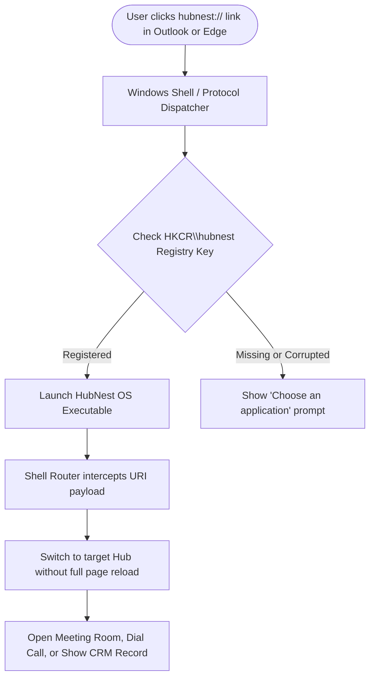

# Custom Protocol Handlers & Deep Linking (`hubnest://`)

Welcome to the **HubNest OS Deep Linking & Protocol Handler Guide**. As an IT Administrator, one of your key responsibilities is ensuring employees can seamlessly launch meetings, dial telephone numbers, and jump directly to CRM deals or HR leave forms from their browsers, email clients (such as Microsoft Outlook), and intranet portals without manual copy-pasting.

HubNest OS registers a universal native protocol handler named **`hubnest://`** upon installation. This guide covers how the protocol operates, its syntax, enterprise registry configuration, browser security prompts, and end-to-end testing.

---

## 1. How Protocol Deep Linking Works

When an employee clicks a link formatted as `hubnest://...` in an email or web dashboard, the operating system intercepts the command, locates the registered HubNest OS executable, and forwards the target destination directly to the desktop shell.



### Key Advantages for Your Enterprise
- **Zero Friction Collaboration:** Users click an Outlook calendar invitation link and instantly land inside HubMeet desktop with their microphone and camera pre-initialized.
- **One-Click Telephony:** Clicking a telephone number on an intranet directory triggers Calling Hub to dial immediately through the desktop softphone.
- **Context Preservation:** If HubNest OS is already running in the background system tray, it instantly gains window focus and routes to the record in under 200 milliseconds.

---

## 2. Supported Protocol URI Syntax

The `hubnest://` protocol supports dedicated routing parameters across all HubNest ecosystem modules:

| Target Module | URI Syntax Pattern | Example Enterprise Link | Intended Action |
| :--- | :--- | :--- | :--- |
| **HubMeet** | `hubnest://meet/{meeting_id}` | `hubnest://meet/eng-daily-sync` | Launches HubMeet and automatically joins the designated conference room. |
| **Calling Hub** | `hubnest://calling/dial?phone={number}` | `hubnest://calling/dial?phone=+18005550199` | Activates the softphone dialpad and dials the destination number immediately. |
| **HubCRM** | `hubnest://crm/leads/{lead_id}` | `hubnest://crm/leads/LD-9482` | Opens the specific lead profile card directly in HubCRM. |
| **HubCRM Deals** | `hubnest://crm/deals/{deal_id}` | `hubnest://crm/deals/DL-104` | Navigates directly to the sales pipeline deal modal. |
| **HubHRMS Leaves** | `hubnest://hrms/leaves/apply` | `hubnest://hrms/leaves/apply` | Pops up the pre-filled leave application drawer. |
| **HubNotification** | `hubnest://notification/inbox` | `hubnest://notification/inbox` | Brings the unified alert inbox to foreground focus. |

> [!TIP]
> **Query String Parameters:** You can append optional parameters such as `?autojoin=true` or `?muted=true` to conference links:
> `hubnest://meet/board-q3-review?autojoin=true&muted=true`

---

## 3. Windows Registry Registration Details

During standard MSI or Setup installation, HubNest OS registers the protocol keys under `HKEY_CLASSES_ROOT` (system-wide) or `HKEY_CURRENT_USER\Software\Classes` (per-user).

### Registry Key Structure
```text
HKEY_CLASSES_ROOT\hubnest
  (Default) = "URL:HubNest Protocol"
  "URL Protocol" = ""
  \shell
    \open
      \command
        (Default) = "C:\Program Files\HubNest\HubNestOS.exe" "%1"
```

### Verifying Registration via PowerShell
To verify that the protocol handler is correctly registered on managed endpoints, open PowerShell as Administrator and run:

```powershell
Get-ItemProperty -Path "Registry::HKEY_CLASSES_ROOT\hubnest\shell\open\command"
```

**Expected Healthy Output:**
```text
(default)    : "C:\Program Files\HubNest\HubNestOS.exe" "%1"
PSPath       : Microsoft.PowerShell.Core\Registry::HKEY_CLASSES_ROOT\hubnest\shell\open\command
```

> [!IMPORTANT]
> If deploying HubNest OS via custom scripts or unattended zip packages, you must include a registry `.reg` file or PowerShell script to create this key; otherwise, browsers will not recognize `hubnest://` URLs.

---

## 4. Browser Security & One-Click Prompt Whitelisting

When a user clicks a `hubnest://` link in Google Chrome or Microsoft Edge for the first time, the browser displays a standard confirmation dialog:
> *"Open HubNest OS? https://intranet.company.com wants to open this application."*

To streamline the employee experience and prevent repeated prompts, IT Administrators can deploy enterprise browser policies to automatically whitelist the protocol for corporate origins.

### Microsoft Edge Enterprise Policy (GPO / Intune)
Configure the **`AutoLaunchProtocolsFromOrigins`** policy in Edge:

```json
[
  {
    "protocol": "hubnest",
    "allowed_origins": [
      "https://*.company.com",
      "https://hubnest.yourdomain.com"
    ]
  }
]
```

#### In Group Policy Editor:
1. Navigate to: `Computer Configuration` > `Administrative Templates` > `Microsoft Edge`.
2. Locate **Define a list of protocols that can launch an external application from listed origins without user prompt**.
3. Enable the policy and paste the JSON string above.
4. Run `gpupdate /force` on client workstations.

### Google Chrome Enterprise Policy
Configure the same policy under `Software\Policies\Google\Chrome\AutoLaunchProtocolsFromOrigins`:
```reg
Windows Registry Editor Version 5.00

[HKEY_LOCAL_MACHINE\SOFTWARE\Policies\Google\Chrome\AutoLaunchProtocolsFromOrigins]
"1"="[{\"protocol\":\"hubnest\",\"allowed_origins\":[\"https://*.company.com\"]}]"
```

---

## 5. End-to-End Testing & Verification

Follow these steps to verify that deep linking is operating properly across your test machines:

### Step 1: Windows Run Box Test
1. Press `Windows Key + R` to open the Windows Run dialog.
2. Type:
   ```text
   hubnest://meet/test-it-room
   ```
3. Press **Enter**.
4. **Result:** HubNest OS must launch immediately (or restore from the system tray) and navigate directly to the HubMeet room `test-it-room`.

### Step 2: Web Browser Test
1. Open Microsoft Edge or Google Chrome on the managed machine.
2. In the browser address bar, type `hubnest://calling/dial?phone=12345` and press Enter.
3. Confirm that HubNest OS opens and places the phone number in the Calling Hub dialer.

### Step 3: Email Client Test (Outlook)
1. Send a test email containing a clickable hyperlink with destination `hubnest://hrms/leaves/apply`.
2. Click the link inside the email body.
3. Verify that the leave request drawer opens smoothly in HubNest OS.

---

## 6. Troubleshooting Protocol Issues

| Symptom | Probable Cause | Administrative Remediation |
| :--- | :--- | :--- |
| **"Choose an application" dialog appears every time** | The registry command string is missing double quotes around `%1`. | Ensure the registry command is formatted strictly as `"C:\Program Files\HubNest\HubNestOS.exe" "%1"`. |
| **Browser blocks the link as insecure or unknown** | Corporate browser policy blocks unregistered protocols. | Add `hubnest` to the `AutoLaunchProtocolsFromOrigins` policy as outlined in Section 4. |
| **HubNest OS opens but stays on the default Dashboard** | The argument parser received an encoded URL that failed validation. | Verify that query parameters use valid standard URI encoding (e.g., spaces converted to `%20`). |
| **Meeting room ID is cut off or truncated** | Special characters in meeting tokens (such as `&` or `#`) without proper escaping. | Ensure web portals URL-encode parameter values before constructing the `hubnest://` string. |

---

## 7. IT Administrator Best Practice Summary
1. Always deploy protocol handler registry keys machine-wide during the initial MSI installation.
2. Push Edge and Chrome `AutoLaunchProtocolsFromOrigins` policies across all employee machines to eliminate intrusive confirmation popups.
3. Keep URL query parameters clean and standard-compliant to ensure fast, glitch-free screen routing.
