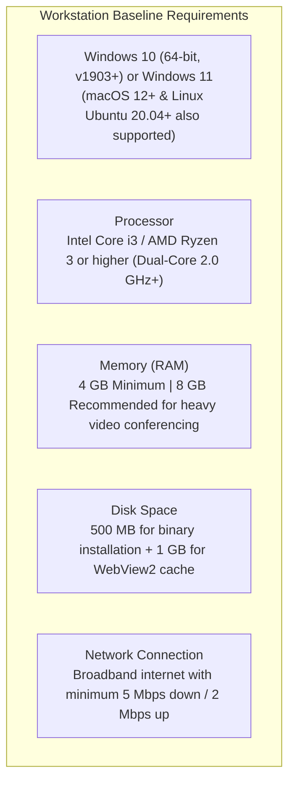
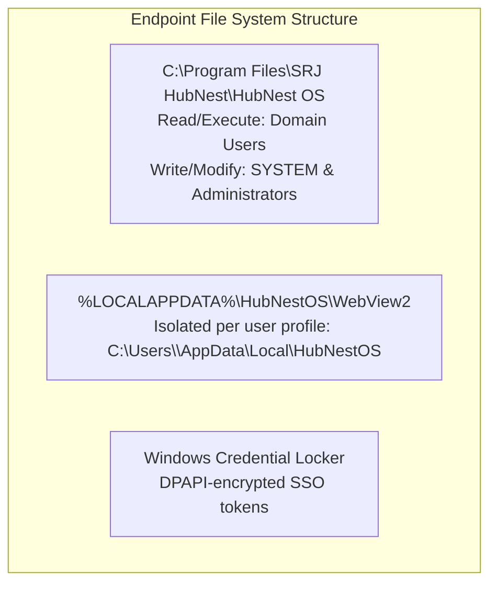

# Hardware Specifications & Microsoft Edge WebView2 Governance

To ensure smooth 60 FPS video performance, rapid hub switching, and robust enterprise stability across your corporate fleet, workstations must satisfy baseline hardware and software prerequisites. This guide details system requirements and covers the deployment and lifecycle governance of the **Microsoft Edge WebView2 Evergreen Runtime**.

---

## 1. Workstation Hardware & OS Specifications



---

## 2. Understanding the Microsoft Edge WebView2 Runtime

HubNest OS utilizes the **Microsoft Edge WebView2 Runtime** as its core Chromium web rendering engine:

```mermaid
graph LR
    A[HubNest OS Flutter Shell] --> B[Microsoft Edge WebView2 Runtime Engine]
    B --> C[Sandboxed Process Model: Isolated GPU & Media Rendering]
    B --> D[Hardware Video Acceleration (DirectX / Direct3D)]
    B --> E[Auto-Patched Bi-Weekly by Microsoft for Zero-Day Vulnerabilities]
```

### Why WebView2 is the Enterprise Standard:
- **Automatic Security Patching:** Unlike legacy Electron apps that bundle an outdated Chromium version, WebView2 is an **Evergreen Runtime** that receives security updates and zero-day patches directly through Windows Update automatically.
- **Shared Memory Architecture:** If multiple HubNest hubs or other enterprise apps (e.g., Microsoft Teams) use WebView2, the operating system shares identical code in physical RAM, drastically reducing your computer's total memory footprint.

---

## 3. Detecting & Installing WebView2 on Windows

On **Windows 11** and modern versions of **Windows 10**, Microsoft Edge WebView2 is already pre-installed as an operating system component.

### Verifying Installation via PowerShell:
Run the following PowerShell one-liner to verify if WebView2 is installed on a client endpoint:

```powershell
Get-ItemProperty -Path "HKLM:\SOFTWARE\WOW6432Node\Microsoft\EdgeUpdate\Clients\{F3017226-FE2A-4295-8BDF-00C3A9A7E4C5}" | Select-Object -ExpandProperty pv
```
- If this command returns a version string (e.g., `129.0.2792.89`), WebView2 is installed and fully operational.
- If it returns empty, WebView2 must be installed.

### Silent Unattended WebView2 Installation:
If deploying to a legacy or stripped Windows 10 LTSC image that lacks WebView2:
1. Download the official **Evergreen Bootstrapper** (`MicrosoftEdgeWebview2Setup.exe`) from Microsoft.
2. Execute the silent install command in your deployment script:
   ```cmd
   MicrosoftEdgeWebview2Setup.exe /silent /install
   ```
3. The installer downloads and configures the latest runtime in less than 45 seconds.

---

## 4. File System Paths & Storage Governance

HubNest OS adheres to strict Windows file system standards to support multi-user shared machines:



- **Application Binaries:** `C:\Program Files\SRJ HubNest\HubNest OS\`
  - Locked to read-only for standard non-admin domain users. Only elevated installers or SYSTEM accounts can modify this folder.
- **User Data Directory (EBWebView Cache):** `%LOCALAPPDATA%\HubNestOS\WebView2\`
  - Stores local cached cookies, local storage, and GPU shader caches.
  - Automatically isolated inside each user's unique Windows profile. User A cannot access or inspect User B's cached session data on shared conference room laptops.
- **Session Tokens:** Encrypted directly with Windows DPAPI (Data Protection API) via `flutter_secure_storage`.
