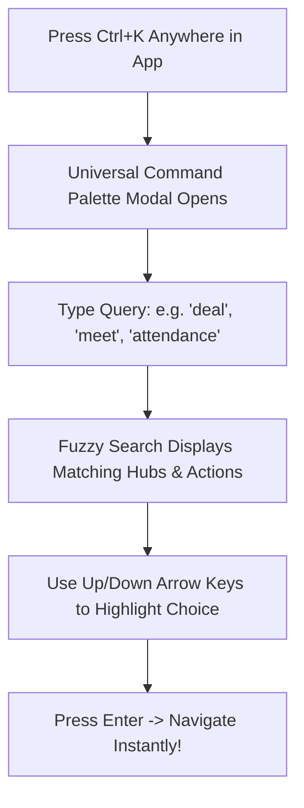
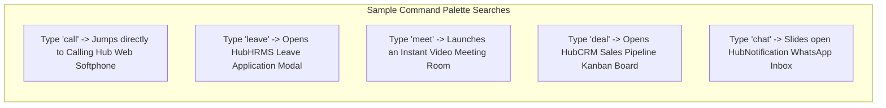
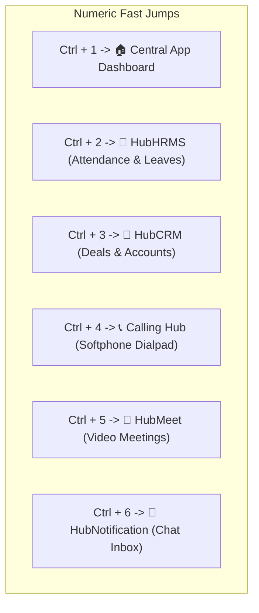

# Universal Command Palette & Master Hotkeys

Power users and fast-paced professionals rarely rely on mouse clicks alone. HubNest OS features a lightning-fast **Universal Command Palette (`Ctrl+K`)** and global desktop hotkeys that let you search across all company applications, execute quick actions, and jump between business hubs without taking your hands off the keyboard.

---

## 1. Opening the Universal Command Palette (`Ctrl+K`)

Wherever you are inside HubMeet, HubCRM, or HubHRMS:
1. Press **`Ctrl + K`** on Windows/Linux (or **`Cmd + K`** on macOS).
2. The sleek, semi-transparent **Command Palette Dialog** will pop up in the center of your screen.

---

## 2. What You Can Do with the Command Palette

The search box features intelligent fuzzy search and understands both application names and common business actions:

### Tips for Fast Navigation:
- **Zero Mouse Movement:** Press `Ctrl+K`, type `cr`, press `Enter`. You are in HubCRM in under 0.2 seconds.
- **Escape to Dismiss:** If you change your mind, simply press the `Escape` key (`Esc`) to close the palette and return to your active workspace.

---

## 3. Fast Number Jumps (`Ctrl + 1` through `Ctrl + 6`)

For routine daily switching between your top business tools, HubNest OS binds numeric hotkeys to each primary hub:

| Keyboard Shortcut | Destination Hub | Common Scenario |
|---|---|---|
| **`Ctrl + 1`** | **App Dashboard** | Checking your morning agenda and company notices. |
| **`Ctrl + 2`** | **HubHRMS** | Punching attendance in the morning or checking your leave balance. |
| **`Ctrl + 3`** | **HubCRM** | Checking your sales leads, dragging deals to Won, or adding a contact. |
| **`Ctrl + 4`** | **Calling Hub** | Answering an incoming phone call or making an outbound dial. |
| **`Ctrl + 5`** | **HubMeet** | Joining your scheduled team standup or client video call. |
| **`Ctrl + 6`** | **HubNotification** | Replying to an incoming customer WhatsApp inquiry. |

> [!TIP]
> On macOS, use the `Cmd` key (e.g., `Cmd + 1`, `Cmd + 2`) instead of `Ctrl`.

---

## 4. Master Desktop Keyboard Shortcuts Cheat Sheet

Keep this reference table handy to supercharge your daily productivity:

| Shortcut (Windows) | Shortcut (macOS) | Action Performed |
|---|---|---|
| **`Ctrl + K`** | **`Cmd + K`** | **Open Universal Command Palette** (Search apps & actions). |
| **`Ctrl + B`** | **`Cmd + B`** | **Toggle Left Sidebar** (Expand or collapse to icons-only). |
| **`Ctrl + 1` – `Ctrl + 6`** | **`Cmd + 1` – `Cmd + 6`** | **Jump to Specific Hub** (Dashboard, HRMS, CRM, Calling, Meet, Notifications). |
| **`Ctrl + R`** or **`F5`** | **`Cmd + R`** | **Reload Active Tab** (Refreshes the current hub without affecting others). |
| **`Ctrl + Shift + M`** | **`Cmd + Shift + M`** | **Mute / Unmute Microphone Globally** (Works even when app is minimized). |
| **`Ctrl + Shift + D`** | **`Cmd + Shift + D`** | **Toggle Do Not Disturb** (Silences incoming call chimes and notification toasts). |
| **`Escape`** | **`Escape`** | **Dismiss Modal / Close Dialog** (Closes palette or popups). |

---

## 5. Customizing Hotkeys

If any default shortcut conflicts with another software program installed on your computer (e.g., a screen recorder or code editor):
1. In the bottom left corner of the desktop sidebar, click **Settings (Gear Icon)**.
2. Select **Keyboard Shortcuts**.
3. Click on the hotkey you wish to change (e.g., `Ctrl + K`).
4. Press your desired combination on your keyboard (e.g., `Ctrl + Space`).
5. Click **Save Shortcuts**.
