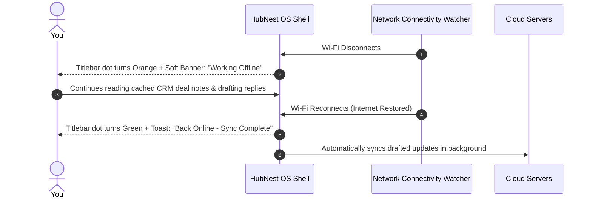

# Hardware Setup, Audio/Video & Offline Resilience

Reliable communication depends on two critical foundations: correctly configured audio/video hardware, and network resilience during unexpected Wi-Fi drops. HubMeet OS provides direct hardware control over your headset and webcam, GPU hardware acceleration, and an intelligent **Offline Connectivity Engine** that preserves your work during network interruptions.

---

## 1. Hardware Setup (Microphone, Camera & Speakers)

Unlike web browsers that require granting permissions tab by tab, HubNest OS manages audio and video devices globally across all hubs:

```mermaid
graph TD
    A[Open Desktop Settings -> Hardware] --> B[Microphone Selection & Live Sound Barometer]
    A --> C[Audio Output / Headset Selection with 'Test Sound' Chime]
    A --> D[Webcam Selection with Live HD Video Mirror]
    A --> E[Hardware Acceleration (GPU) Toggle for Smooth 60 FPS]
```

### How to Configure Hardware Devices:
1. In the bottom left corner of the desktop sidebar, click **Settings (Gear Icon)** $\rightarrow$ **Audio & Video Hardware**.
2. **Microphone (Audio Input):** Select your preferred headset microphone. Speak a sentence; the green volume meter should bounce actively between 40% and 80%.
3. **Speakers (Audio Output):** Select your headphones so ring chimes and caller voices play in your ears rather than loud laptop speakers. Click **Play Test Tone** to verify audio clarity.
4. **Webcam (Video Input):** Choose your camera (built-in or USB webcam). A live video mirror will confirm proper framing and lighting.
5. Click **Apply Device Settings**. These choices are applied automatically across Calling Hub, HubMeet, and video messages.

---

## 2. Enabling GPU Hardware Acceleration

HubNest OS leverages your computer's graphics card (GPU) through the **Microsoft Edge WebView2 Engine** to render video meetings and complex data tables smoothly:

- **Why It Matters:** Offloading video decoding to your GPU prevents your laptop's CPU from overheating, keeps fans quiet, and extends laptop battery life by up to 35%.
- **How to Enable:** In **Settings** $\rightarrow$ **Performance**, ensure **[✓] Use GPU Hardware Acceleration when available** is toggled to `Active`.

> [!TIP]
> If you ever experience video screen flickering on older computer hardware, you can toggle hardware acceleration off to fall back to software rendering.

---

## 3. Offline Mode & Network Disconnection Handling

In the real world, office Wi-Fi networks can momentarily drop, or you might step into an elevator with your laptop. In a web browser, this results in an error screen and lost form entries.

HubNest OS features an integrated **Network Connectivity Service**:



### What Happens During a Disconnect:
1. **Visual Status Indicator:** The green network dot in the top titlebar turns orange, and a non-intrusive banner appears: *"Network connection lost. HubNest OS is running in Offline Mode."*
2. **Cached Data Remains Accessible:** You can continue browsing previously loaded CRM contact directories, HRMS employee registers, and task boards.
3. **No Lost Forms:** Text typed into notes or task descriptions is safely preserved in local memory.
4. **Seamless Auto-Reconnection:** The moment your Wi-Fi or Ethernet reconnects, HubNest OS detects the network restoration automatically, syncs your changes with the cloud server, and restores live calling without requiring you to reload the application.

---

## 4. Resetting Cache & Troubleshooting Glitches

If a specific hub appears frozen or if you need to clear old cached cookies:

1. **Quick Refresh (Active Tab Only):** Press **`Ctrl + R`** (or **`F5`**). HubNest OS will refresh only the active hub without affecting any of your other open tabs.
2. **Clearing WebView2 Cache:**
   - Go to **Settings** $\rightarrow$ **Diagnostics & Cache**.
   - Click **Clear Cache & Temporary Files**.
   - HubNest OS safely empties the `%LOCALAPPDATA%\HubNestOS\WebView2` directory and restarts the rendering engine fresh.
