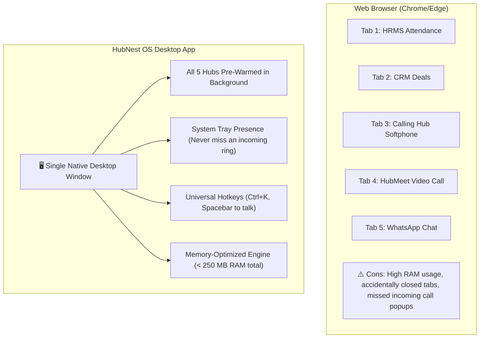
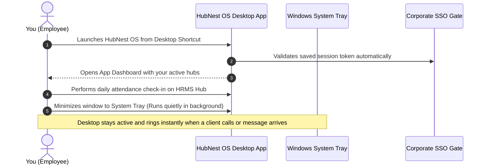
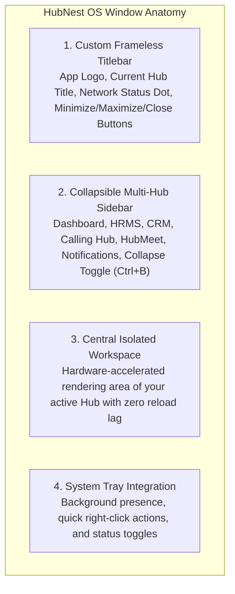

# HubNest OS Desktop App Overview & Daily Routine

Welcome to the **HubNest OS Desktop App Guide**. As a modern professional, your daily workflow requires jumping between attendance check-ins, sales CRM pipelines, VoIP client calls, video conferences, and customer support chats. Managing these across 15 to 25 open browser tabs often leads to lost tabs, high computer memory (RAM) usage, accidental tab closures, and missed phone calls.

**HubNest OS** replaces browser chaos with a unified, high-performance desktop workstation. Built with native hardware acceleration, an instant **Multi-Hub Switcher**, a **Universal Command Palette (`Ctrl+K`)**, and **Background System Tray Running**, HubMeet, HubCRM, HubHRMS, Calling Hub, and HubNotification run harmoniously inside a single desktop window.

---

## 1. Why Use the Desktop App Instead of a Web Browser?

| Operational Feature | Standard Web Browser | HubNest OS Desktop App |
|---|---|---|
| **Memory (RAM) Footprint** | 1.5 GB to 3.0 GB across multiple tabs. | **Under 250 MB** via pooled background suspension. |
| **Incoming Phone Calls** | Only rings if the specific tab is open and unmuted. | **Rings reliably anytime**, even if minimized to the system tray. |
| **Tab Switching Speed** | 2 to 4 seconds to reload web pages. | **Instant (0.1 seconds)** with zero reloading lag. |
| **Global Keyboard Shortcuts** | Hotkeys only work if the browser tab has focus. | **Global Hotkeys (`Ctrl+K`)** work across all hubs. |
| **Hardware Access** | Constant browser permission popups. | **Direct, seamless access** to webcam, mic, and headphones. |
| **Offline Resilience** | Shows "No Internet" dinosaur error screen. | **Maintains offline cache** and auto-syncs upon reconnect. |

---

## 2. Daily Employee Launch Checklist

Follow this simple 3-step routine at the start of every workday:

### Step 1: Launch & Automatic Sign-In
- Double-click the **HubNest OS** icon on your Windows desktop or Taskbar.
- Because HubNest OS securely caches your credentials in the Windows Credential Locker, you are signed in automatically without retyping passwords every morning.

### Step 2: Review Your Central Dashboard
- The central launcher opens, presenting an executive snapshot of your day:
  - Your scheduled video meetings in **HubMeet**
  - Your assigned tasks and leads in **HubCRM**
  - Your pending attendance punches in **HubHRMS**
  - Unread customer messages in **HubNotification**

### Step 3: Minimize to System Tray
- When you are working in other software (e.g., Excel or Word), simply click the window **Minimize** or **Close (`X`)** button.
- HubNest OS does not exit; it shrinks quietly into your Windows taskbar notification tray.
- If an incoming phone call rings on Calling Hub or a colleague messages you on HubNotification, an audible chime and native Windows toast notification will pop up on your screen instantly.

---

## 3. Desktop Window Anatomy

The HubNest OS interface is designed to be sleek, distraction-free, and maximize your screen real estate:

| Window Area | What It Contains | How to Use |
|---|---|---|
| **Custom Title Bar** | Company brand logo, active hub title, network connection indicator (Green = Online, Orange = Reconnecting), and native window control buttons. | Drag the titlebar to move the window. Double-click to maximize or restore down. |
| **Left Sidebar** | Icons for every business hub you are entitled to use. | Click any icon to switch hubs instantly. Click the bottom collapse button (or press `Ctrl+B`) to expand or collapse. |
| **Main Stage** | Full-width workspace rendering your active hub. | Complete interactive interface with hardware-accelerated scrolling and media streaming. |

---

## 4. Next Steps in this Guide

Explore the individual user guides below to master your desktop workspace:

- 📥 **[Installation, Launch & SSO Login](installation-login.md):** Downloading the installer, running the setup wizard, and signing in with Single Sign-On.
- 🗂️ **[Multi-Hub Navigation & Switching](multi-hub-navigation.md):** Switching between HRMS, CRM, Calling, Meet, and Notifications with zero reloading lag.
- ⌨️ **[Command Palette & Global Hotkeys](command-palette-shortcuts.md):** Using `Ctrl+K` to search across all hubs and mastering keyboard shortcuts.
- 🔔 **[System Tray & Background Running](system-tray-background.md):** Running quietly in the background, receiving incoming calls, and startup on boot.
- 🎙️ **[Hardware Setup & Offline Mode](hardware-offline-mode.md):** Configuring microphones, webcams, Edge WebView2 acceleration, and handling network drops.
