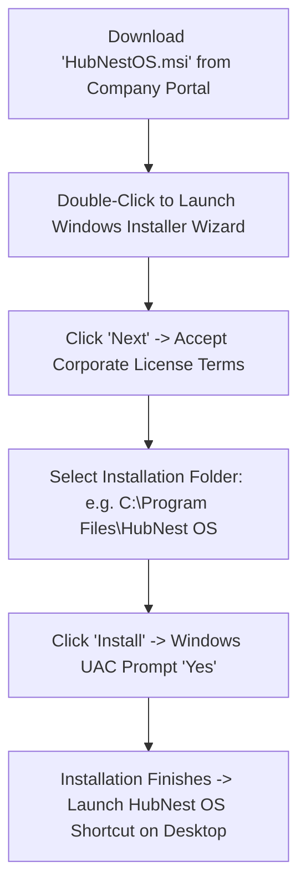
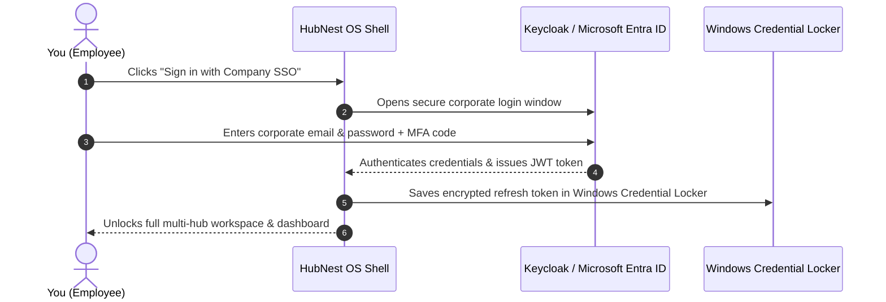

# Installation, Launch & Single Sign-On (SSO)

Getting started with HubNest OS on your computer takes less than two minutes. The application installs as a clean, self-contained desktop package on Windows, automatically configures necessary media drivers, and links seamlessly with your organization's Single Sign-On (SSO) account.

---

## 1. System Requirements

Before installing HubNest OS, ensure your workstation meets these basic criteria:

- **Operating System:** Windows 10 (64-bit, Version 1903 or higher) or Windows 11. *(macOS 12+ and Linux Ubuntu 20.04+ are also supported).*
- **Processor:** Intel Core i3 / AMD Ryzen 3 or higher.
- **Memory (RAM):** 4 GB RAM minimum (8 GB recommended for heavy video calling).
- **Disk Space:** 500 MB of available hard drive space.
- **Runtime Dependency:** **Microsoft Edge WebView2 Runtime** (pre-installed on almost all Windows 10/11 computers; the installer will automatically download it if missing).

---

## 2. Downloading & Installing on Windows

### Step-by-Step Installation:
1. Download the latest installer package (`HubNestOS.msi` or `HubNestOS-Setup.exe`) from your company's software downloads portal.
2. Double-click the downloaded file to launch the **HubNest OS Setup Wizard**.
3. In the welcome screen, click **Next**.
4. Review and accept the software license agreement, then click **Next**.
5. Keep the default installation directory (`C:\Program Files\SRJ HubNest\HubNest OS`), or click *Browse* to choose a custom location.
6. Click **Install**.
7. If prompted by Windows User Account Control (UAC): *"Do you want to allow this app to make changes to your device?"*, click **Yes**.
8. Once the progress bar reaches 100%, check **Launch HubNest OS** and click **Finish**.

> [!NOTE]
> If your company manages your computer via Microsoft Intune or Active Directory, HubNest OS may already be pre-installed by your IT department. Search for *"HubNest OS"* in your Windows Start Menu.

---

## 3. Signing In with Single Sign-On (SSO)

When you launch HubNest OS for the first time, the unified authentication screen appears:

### How to Sign In:
1. On the login screen, enter your registered **Corporate Email Address** (e.g., `alex@yourcompany.com`).
2. **If your company uses Single Sign-On:** Click the blue **Sign in with Company SSO** button. A secure browser authentication window will open where you authenticate using your corporate Google, Microsoft 365, or Keycloak credentials and hardware MFA token.
3. **If using Direct Password:** Enter your password in the password field and click **Sign In**.
4. Check the box: **[✓] Keep me signed in on this computer**.
5. Click **Continue**.

---

## 4. Session Persistence & Automatic Sign-In

You do **not** need to re-enter your password every morning:

- **Windows Credential Locker Integration:** HubNest OS securely encrypts your session refresh token inside the native Windows Credential Locker using `flutter_secure_storage`.
- **Zero-Friction Morning Launches:** When you turn on your computer and launch HubNest OS, the app automatically verifies your session in the background and takes you straight to your workspace in under 1 second.
- **Corporate Password Expiration:** If your corporate password expires (e.g., every 90 days as mandated by IT), HubMeet displays a gentle notification prompting you to authenticate via SSO again.

---

## 5. Signing Out or Switching Accounts

If you are using a shared workstation and need to log out:
1. In the bottom left corner of the desktop sidebar, click your **Profile Avatar**.
2. Click **Sign Out**.
3. A confirmation dialog will ask: *"Are you sure you want to sign out? This will clear local cached session tokens."*
4. Click **Confirm Sign Out**.
5. You are returned to the initial login screen, ready for the next team member to sign in.
