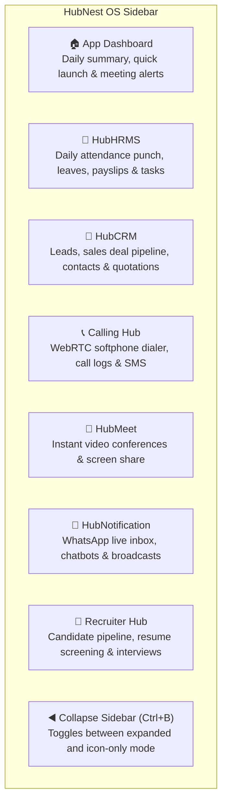
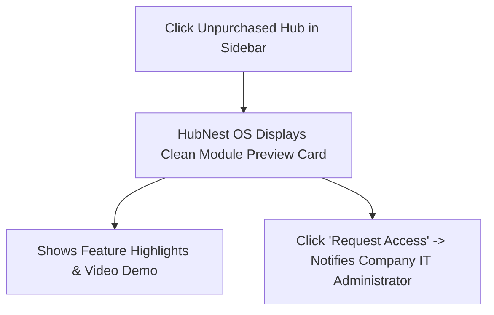

# Multi-Hub Navigation & Instant App Switching

The core innovation of HubNest OS is its **Multi-Hub Workspace Architecture**. Instead of navigating complex browser bookmarks or managing multiple separate desktop windows, all your enterprise tools—**HRMS**, **CRM**, **Calling Hub**, **HubMeet**, and **HubNotification**—live inside a single, unified desktop shell with **Instant, Zero-Reload App Switching**.

---

## 1. The Collapsible Multi-Hub Sidebar

The left sidebar is your command strip for navigating between business applications:



### Expanding & Collapsing the Sidebar:
- **Expanded Mode (Default):** Displays large icons alongside readable text labels (e.g., *HubCRM*, *HubMeet*).
- **Collapsed Mode (Icon-Only):** Click the small **Collapse Arrow (`◀`)** at the bottom of the sidebar (or press `Ctrl+B` on your keyboard) to shrink the sidebar into a slim icon strip, dedicating 96% of your monitor width to your active workspace.

---

## 2. Zero-Reload Switching: How the WebView2 Pool Works

In a standard web browser, clicking between CRM and Calling Hub reloads the web page. If you were in the middle of typing a customer note or filling out an invoice, that unsaved text is often lost.

HubNest OS solves this problem with its background **WebView2 Pool Manager**:

```mermaid
graph LR
    A[You are Working in HubCRM\nTyping a Deal Proposal] -->|Click 'Calling Hub' in Sidebar| B[Calling Hub Activates Instantly (0.1s)]
    B --> C[Make Softphone Call to Customer]
    C -->|Click 'HubCRM' in Sidebar| A
    A --> D[HubCRM Resumes Exactly Where You Left It with All Form Fields Intact!]
```

- **Instant Switching:** Switching between Hubs takes less than 100 milliseconds—faster than switching windows on your computer.
- **Form State Preservation:** Unsaved notes, drafted customer emails, half-filled leave requests, and search queries remain untouched in memory when you switch away.
- **Smart Background Suspension:** When a hub is inactive in the background, HubNest OS automatically pauses animations and background timers, keeping overall computer memory usage lean (< 250 MB).

---

## 3. Tour of the Primary Hubs

Click on any sidebar icon to jump into that specific application:

| Hub Name | Primary Business Purpose | Key Daily Actions |
|---|---|---|
| **🏠 Dashboard** | Executive Home Launcher | View daily agenda, urgent notifications, and 1-click jump cards. |
| **👥 HubHRMS** | People & Workforce Management | Daily attendance punch-in/out, apply for sick leave, view PDF payslips, track milestones. |
| **💼 HubCRM** | Sales, Deals & Customer Pipelines | Qualify incoming leads, drag deal cards across Kanban stages, send price quotes, manage accounts. |
| **📞 Calling Hub** | VoIP Telephony & Web Softphone | Place outbound browser phone calls, answer incoming rings, view call durations, listen to audio recordings. |
| **🎥 HubMeet** | Video Meetings & Collaboration | Launch instant HD video calls, share presentation slides, sketch on digital whiteboards. |
| **🔔 HubNotification** | Omnichannel Live Chat Inbox | Reply to WhatsApp customer messages, manage automated AI chatbots, send text broadcasts. |
| **📄 Recruiter Hub** | Talent Acquisition | Review job applications, schedule candidate interviews, send offer letters. |

---

## 4. Unentitled Hubs & Module Previews

Depending on your company's subscription plan, your organization may not have purchased every available Hub (e.g., your company may subscribe to HubHRMS and HubMeet, but not Calling Hub).



- If you click an unpurchased module, HubNest OS will not crash or show an error screen.
- Instead, an informative **Module Preview Card** appears, highlighting key features and providing an automated **Request Access** button that sends a notice to your company administrator.
