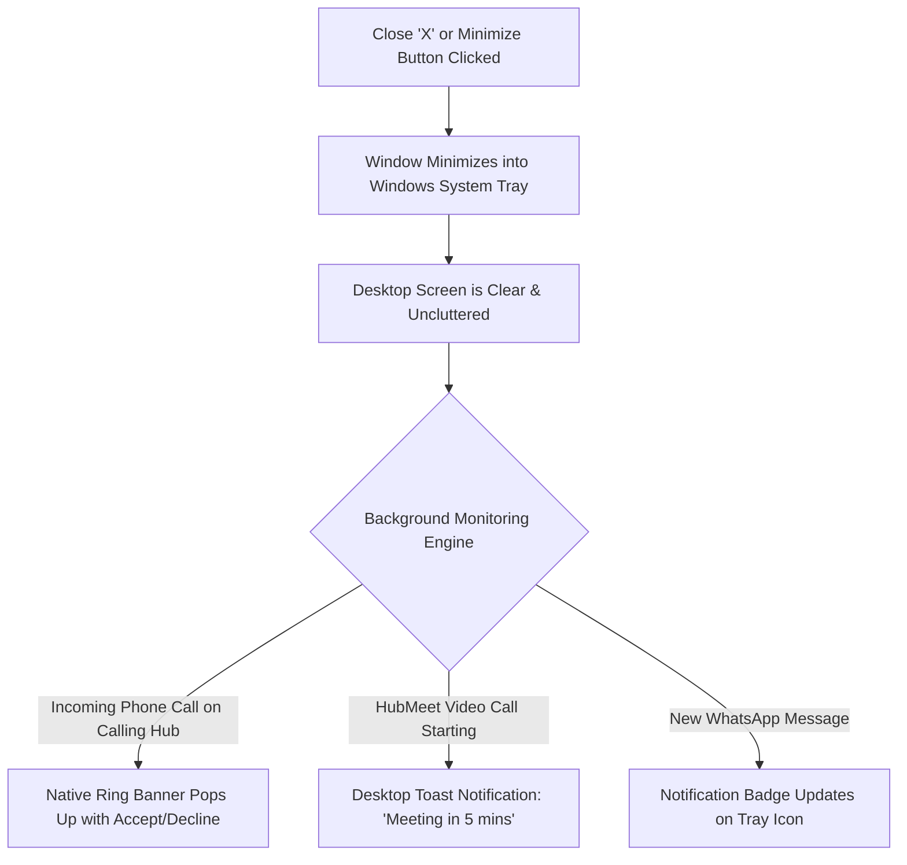
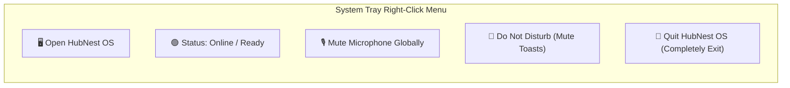
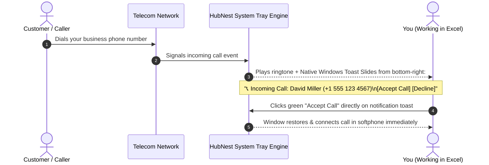

# System Tray & Background Running

When you are working in spreadsheets, reading documents, or drafting emails, you cannot keep your communication windows active on screen all day. HubNest OS integrates directly into the **Windows Taskbar System Tray** (and macOS Menu Bar), allowing the application to run quietly in the background without cluttering your screen—while remaining instantly available when a telephone call or urgent message arrives.

---

## 1. What is the System Tray?

The **System Tray** (also known as the Notification Area) is located in the bottom-right corner of your Windows taskbar, right next to the clock and Wi-Fi icons:

---

## 2. Closing vs. Minimizing: The "Minimize to Tray" Feature

In a standard web browser, clicking the `X` button closes the window and immediately disconnects your phone lines and meetings.

In HubNest OS:
- **Clicking the Close Button (`X`):** Does **not** terminate your session. Instead, it minimizes HubNest OS into the system tray. Your VoIP softphone remains connected, your attendance check-in stays active, and you are ready to receive calls.
- **Double-Clicking the Tray Icon:** Double-click the blue HubNest logo in your system tray to instantly restore the full desktop window back onto your screen.

---

## 3. Right-Click Context Menu Actions

Right-click the HubNest icon in your system tray to reveal instant quick-actions:

| Menu Option | Action Performed | When to Use It |
|---|---|---|
| **Open HubNest OS** | Brings the main application window to the foreground. | When you want to check leads or join a call. |
| **Status: Online / Away** | Toggles your presence across all company directories. | Toggle to **Away** when stepping away from your desk for lunch. |
| **Mute Microphone** | Mutes your hardware microphone globally across all hubs. | When you need instant privacy during an in-person office conversation. |
| **Do Not Disturb (DND)** | Silences desktop notification popups and audible ring chimes. | When presenting in an external client meeting or focusing on deep work. |
| **Quit HubNest OS** | Completely shuts down the application and background processes. | At the end of your shift when shutting down your computer. |

---

## 4. Native Windows Toast Notifications

HubMeet and Calling Hub leverage native Windows 10/11 Action Center notifications:

### Direct Notification Actions:
- **Incoming Calls:** Click **Accept** to answer immediately through your headset, or click **Decline** to route the caller to voicemail.
- **Meeting Reminders:** 10 minutes and 2 minutes before a scheduled HubMeet call, a notification appears with a **1-Click Join** button.
- **Customer Chat Messages:** Click on incoming WhatsApp support toasts to jump straight to that customer's chat thread in HubNotification.

---

## 5. Enabling "Launch on Windows Startup"

To ensure you never forget to launch your communication suite in the morning:

1. In HubNest OS, open **Settings** (Gear icon) $\rightarrow$ **Desktop Preferences**.
2. Locate the **System Startup** section.
3. Toggle **[✓] Start HubNest OS automatically on computer startup** to `Active`.
4. Choose startup window behavior:
   - **Launch Minimized to System Tray (Recommended):** The app starts quietly in the background without interrupting your morning computer boot.
   - **Open Full Window:** Opens the full dashboard on your screen upon login.
5. Click **Save Preferences**.
