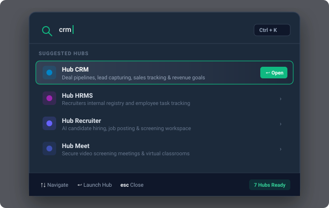
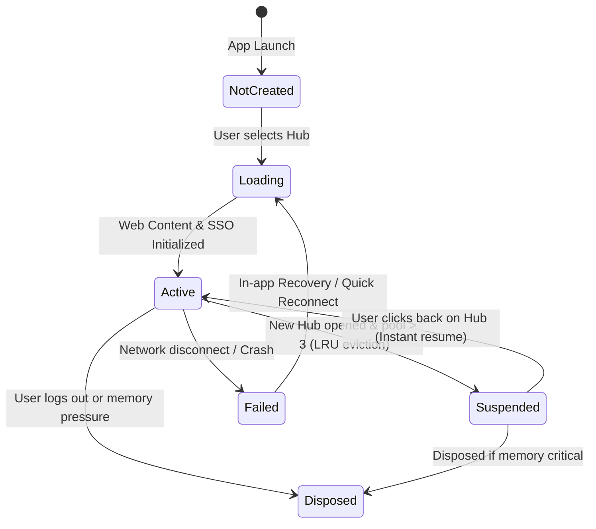

# Multi-Hub Navigation, Tabs & Shortcuts

HubNest OS transforms multiple disparate enterprise web portals into a fast, desktop-integrated environment. With dedicated keyboard shortcuts, a global search command palette, and an intelligent **WebView2 Concurrency Pool Manager**, you can glide between complex sales pipelines, employee databases, and live video meetings with zero friction.

> [!TIP]
> **Need a deep dive on shortcuts and navigation?**
> - For everyday usage workflows and multi-tasking tips, see [Multi-Hub Instant Switching](../desktop-user/multi-hub-navigation.md) and [Command Palette & Shortcuts](../desktop-user/command-palette-shortcuts.md).

---

## ⚡ Global Keyboard Shortcuts Matrix

Every critical navigation action in HubNest OS is mapped to a native Windows key combination handled by the `DesktopKeyboardShortcutsWidget`:

| Shortcut Key | Action Performed | Component / Code Target |
| :--- | :--- | :--- |
| <kbd>Ctrl</kbd> + <kbd>1</kbd> | **Switch to Hub HRMS** | Opens or focuses Hub HRMS (`hrms`) container |
| <kbd>Ctrl</kbd> + <kbd>2</kbd> | **Switch to Hub CRM** | Opens or focuses Hub CRM (`crm`) container |
| <kbd>Ctrl</kbd> + <kbd>3</kbd> | **Switch to Hub Recruiter** | Opens or focuses Hub Recruiter (`recruiter`) workspace |
| <kbd>Ctrl</kbd> + <kbd>4</kbd> | **Switch to Hub Campus** | Opens or focuses Hub College Campus placement hub |
| <kbd>Ctrl</kbd> + <kbd>5</kbd> | **Switch to Hub Calling** | Opens or focuses Cloud Calling VoIP dialer |
| <kbd>Ctrl</kbd> + <kbd>6</kbd> | **Switch to Notification** | Opens or focuses Notification Gateway dashboard |
| <kbd>Ctrl</kbd> + <kbd>K</kbd> | **Open Command Palette** | Launches Universal Hub Search dialog |
| <kbd>Ctrl</kbd> + <kbd>R</kbd> | **Reload Active Tab** | Hard reloads current WebView / refreshes grants |
| <kbd>Ctrl</kbd> + <kbd>B</kbd> | **Toggle Sidebar** | Collapses or expands left navigation sidebar |

> [!TIP]
> Shortcuts work system-wide while the HubNest OS window has focus. You can jump directly from a CRM opportunity edit form straight into an HRMS employee check with a single keystroke (<kbd>Ctrl</kbd> + <kbd>1</kbd>).

---

## 🔍 Universal Command Palette (`Ctrl + K`)

The **Command Palette Dialog** (`CommandPaletteDialog`) is an instant keyboard-driven search interface accessible anywhere in the workspace:

{ width="100%" }

### How to Use the Command Palette
1. Press <kbd>Ctrl</kbd> + <kbd>K</kbd> or click the **magnifying glass icon** in the top title bar.
2. Type any hub name or keyword (e.g., `lead`, `payroll`, `call`, `meet`, `recruiter`).
3. Results update in real-time with visual entitlement status indicators:
    * 🟢 **Green Icon**: Licensed hub ready for immediate launch.
    * ⚪ **Gray Icon**: Unlicensed hub (opens the one-click tier upgrade dialog).
4. Click or press <kbd>Enter</kbd> to launch the hub immediately. Press <kbd>Esc</kbd> to dismiss.

---

## 🧠 Intelligent WebView2 Pool & Concurrency Engine

Opening 7 heavy enterprise web applications simultaneously in standard web browsers can consume **3 GB to 5 GB of RAM**, slowing down Windows workstations. 

To solve this, HubNest OS implements an enterprise **WebView Pool Manager** (`WebViewPoolManager`):

### Core Concurrency Safeguards

#### 1. Maximum 3 Active WebViews Limit (`_maxConcurrentWebViews = 3`)
HubNest OS limits concurrent active Chromium rendering processes to a maximum of **3**. When you open a 4th hub, the Least-Recently-Used (LRU) inactive hub is automatically transitioned to `suspended` state, freeing up GPU and rendering memory while preserving its session cookies.

#### 2. Active Call & Meeting Protection Lock (`isCallOrMeetingActive`)
When you are on an active video call in **HubMeet** or dialer call in **Calling Hub**, the system flags the container with `isCallOrMeetingActive = true`.
> [!IMPORTANT]
> **Zero Interruption Guarantee**: The pool manager will **NEVER** suspend or dispose an active call or meeting container, even if you open multiple other hubs during your conversation.

#### 3. Automatic Single Sign-On (SSO) Re-Bootstrap
If a background web session expires or redirects to `/login`, HubNest OS detects the state change and automatically mints a fresh 60-second One-Time Code from `PlatformApiClient`, seamlessly authenticating you back into your workspace without password re-entry.

---

## 🛠️ In-App Error Recovery & Reconnect

If your internet drops or a microservice restarts while viewing a hub, HubNest OS does not show raw browser error screens (`ERR_INTERNET_DISCONNECTED`). Instead, it displays the branded **Desktop Recovery Screen**:

!!! warning "Connection Temporarily Disrupted (Desktop Recovery Mode)"
    **Unable to reach Hub origin (e.g., `crm.srjhubnest.com`).**
    
    Your local desktop session is safely preserved in memory. HubNest OS gives you two one-click recovery actions directly inside the workspace viewport:
    
    * **↻ Retry Connection**: Executes `_handleRetryRecovery()`, safely recreating and re-bootstrapping the underlying WebView2 controller with a newly minted SSO token.
    * **⚡ Quick Reconnect**: Executes `_handleQuickReconnect()`, performing a soft ping to the hub origin and restoring the existing session without clearing cached state.

---

## ⚡ Next Steps
* Read how background minimization, update channels, and support bundles work in [Preferences & Auto-Updates](preferences.md).
* Review the full list of products and integrations in the [Getting Started Overview](../index.md).
