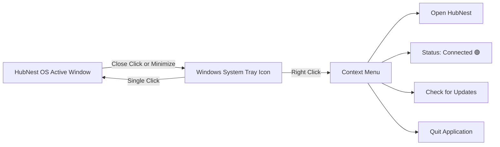
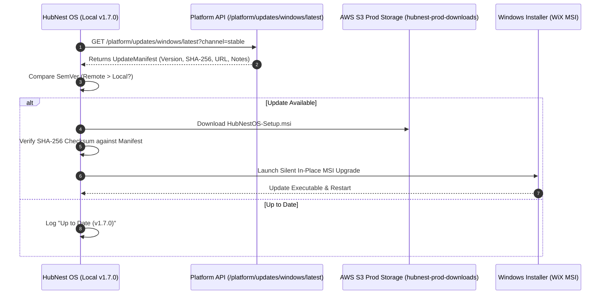
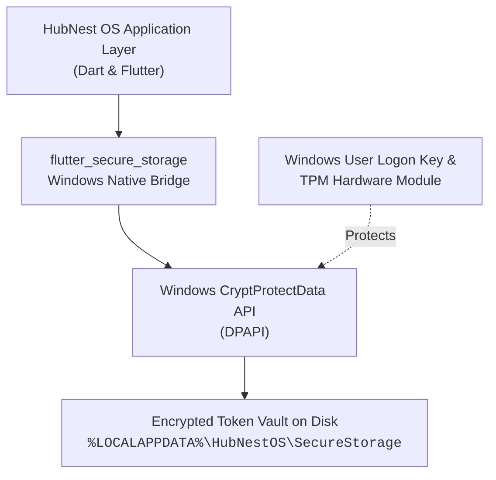

# Preferences, System Tray & Auto-Updates

HubNest OS is engineered for reliable, enterprise-grade deployment on Windows. It operates silently in the background, continuously keeps itself updated with cryptographically verified binaries, and provides one-click sanitized diagnostic bundles for IT administrators.

> [!TIP]
> **Role-Specific Quick Guides:**
> - For everyday background presence and toast notifications, explore [System Tray & Windows Alerts](../desktop-user/system-tray-background.md).
> - For enterprise proxy rules, firewall ports, and update channels, explore [Network, Proxies & Auto-Update](../desktop-admin/network-proxy-updates.md).

---

## 🔔 Windows System Tray Integration

Closing a business application shouldn't mean missing an urgent incoming customer call or a priority notification. HubNest OS embeds deeply into the Windows Taskbar Notification Area via the **System Tray Service** (`SystemTrayService`).



### System Tray Context Menu Actions
When you right-click the HubNest icon in the Windows taskbar tray, the following native actions are available:

1. **Open HubNest**: Restores the window to its saved position (`1440 × 900` or customized) and brings it to the foreground with focus.
2. **Status: Connected 🟢**: Displays live real-time connectivity status to the SRJ Cloud platform gateway.
3. **Check for Updates**: Queries the update server immediately for new releases without restarting the app.
4. **Quit**: Completely disposes all active WebView rendering processes, saves session state to encrypted storage, and gracefully terminates the application.

> [!NOTE]
> Single-clicking the tray icon at any time instantly restores the HubNest OS window to the screen.

---

## 🔄 Auto-Update Engine & Release Channels

HubNest OS includes a built-in enterprise update orchestrator (`AutoUpdateService`) that verifies and delivers updates without requiring manual web downloads.



### Update Manifest Structure
The update engine receives a digitally signed JSON manifest:
```json
{
  "channel": "stable",
  "version": "1.7.0",
  "buildNumber": 14,
  "packageUrl": "https://hubnest-prod-downloads-285629513907.s3.ap-south-1.amazonaws.com/windows/HubNestOS-Setup.msi",
  "sha256": "4b7a9f...e21c",
  "minimumSupportedVersion": "1.0.0",
  "releaseNotes": "Performance improvements for WebView2 pool and LiveKit WebRTC media streams.",
  "releaseDate": "2026-10-10"
}
```

### Supported Release Channels
Organizations can choose between three distinct deployment channels:
* **Stable Channel (`stable`)**: Default for general enterprise production. Receives thoroughly vetted builds with long-term stability.
* **Beta Channel (`beta`)**: Preview builds containing upcoming features for departmental pilot testing.
* **Internal Channel (`internal`)**: Nightly development builds for QA teams and internal testing.

---

## 🔐 Hardware DPAPI Security & Storage Architecture

HubNest OS safeguards sensitive corporate session tokens using Microsoft Windows **Data Protection API (DPAPI)**:




### Security Guarantees
* **Hardware-Backed Encryption**: Tokens encrypted on one Windows user account cannot be decrypted by other user accounts on the same computer, even by local administrators.
* **No Plaintext Passwords**: User passwords are exchanged once with Keycloak IAM over TLS 1.3 and are immediately discarded from application memory.
* **Atomic Sign-Out**: Clicking **Sign Out** in the title bar triggers `WebViewPoolManager.disposeAll()` to purge all session cookies, clears the DPAPI encrypted refresh token, and resets application state to the login gate.

---

## 🩺 Support Diagnostics & Error Bundles

When troubleshooting corporate firewall, VPN, or network proxy issues, users or IT teams can generate an instant, sanitized diagnostic report via the **Support Diagnostics Service** (`SupportDiagnosticsService`).

### Exporting a Diagnostics Bundle
The diagnostics engine compiles live telemetry into a formatted JSON report:

```json
{
  "timestamp": "2026-10-10T16:59:00.000Z",
  "appVersion": "1.7.0+14",
  "osVersion": "Windows 11 Enterprise (Version 10.0.22631)",
  "architecture": "x64",
  "environmentMode": "PRODUCTION",
  "networkStatus": "ONLINE",
  "keycloakReachable": true,
  "platformApiReachable": true,
  "sanitizedErrorLogs": [
    {
      "category": "NETWORK",
      "errorCode": "NET_RETRY_OK",
      "userMessage": "Successfully reconnected to platform gateway.",
      "technicalDetails": "Authorization: Bearer [REDACTED_JWT]",
      "recoveryAction": "NONE",
      "timestamp": "2026-10-10T16:58:30.000Z"
    }
  ]
}
```

### Automatic Secret Redaction
To prevent accidental data leakage when submitting tickets to support:
> [!IMPORTANT]
> **Strict Secret Scrubbing**: All logs automatically redact passwords, access tokens, and JWT tokens before generating the bundle:
> * `password=[REDACTED]`
> * `access_token=[REDACTED]`
> * `Bearer [REDACTED_JWT]`

---

## 📁 Installation & File Locations Reference

For system administrators deploying HubNest OS via Microsoft Intune, Group Policy (GPO), or SCCM:

| Component | Filesystem Path | Purpose |
| :--- | :--- | :--- |
| **Executable Binary** | `C:\Program Files\HubNest\HubNestOS\HubNestOS.exe` | Main application host executable |
| **WebView2 Data Profile** | `%LOCALAPPDATA%\HubNestOS\WebView2\` | Chromium cache, local storage & partition cookies |
| **Secure Token Vault** | `%LOCALAPPDATA%\HubNestOS\SecureStorage\` | DPAPI encrypted session credentials |
| **Diagnostic Logs** | `%LOCALAPPDATA%\HubNestOS\logs\` | Rotated application error and telemetry logs |

---

## ⚡ Next Steps
* Return to the [HubNest Documentation Home](../index.md) to explore cloud modules, integrations, and user guides.
* Review [Multi-Hub Navigation & Tabs](navigation.md) for complete keyboard shortcuts and multi-tasking workflows.
