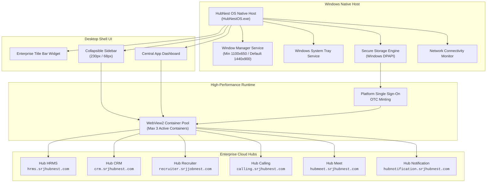
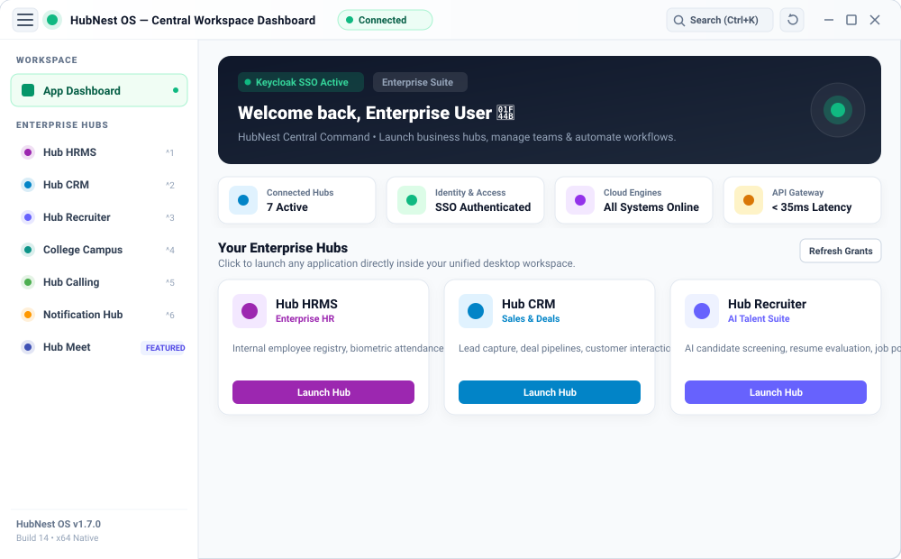
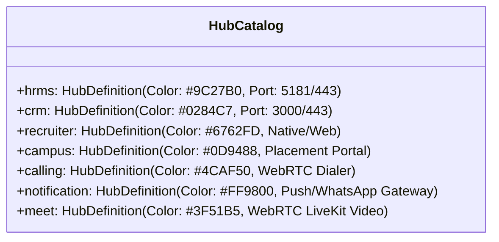
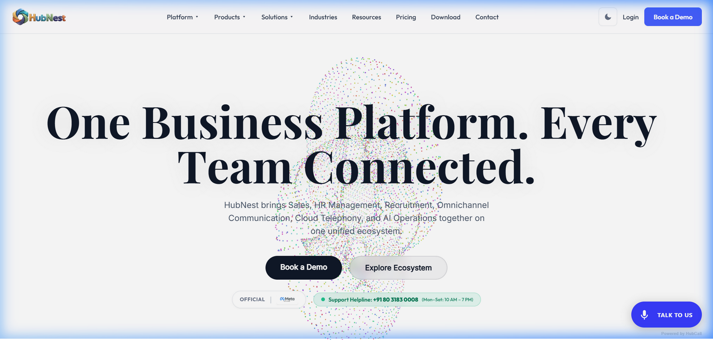
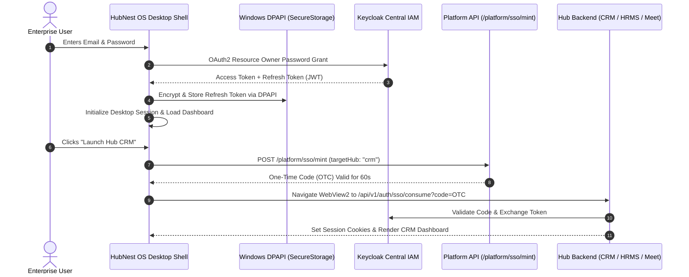

# HubNest OS Workspace Overview

**HubNest OS** is the unified enterprise desktop client built specifically for Windows 10/11 (64-bit). Built on a high-performance **Flutter native desktop shell** paired with the **Microsoft Edge WebView2 Chromium runtime**, HubNest OS eliminates messy browser tabs by bringing your entire business ecosystem into a single, hardware-accelerated workstation.

{ width="260" }

> [!TIP]
> **Role-Specific Quick Guides:**
> - Looking for daily shortcuts, tray alerts, and multi-hub switching? Explore the [Desktop User & Remote Employee Guide](../desktop-user/index.md).
> - Managing enterprise MSI rollouts, GPO, or network firewalls? Visit the [IT Administrator & Deployment Guide](../desktop-admin/index.md).

---

## 🏗️ Desktop Architecture & Runtime Model

Unlike traditional web-wrapped shells that spawn multiple heavy Chromium processes, HubNest OS operates on a **hybrid native container architecture**:

### Key Technical Specifications
* **Native Executable**: `HubNestOS.exe` (WiX Toolset MSI installer deployed to `%ProgramFiles%\HubNest\HubNestOS\`).
* **Display Resolutions**: Default launch footprint is **1440 × 900 px** with an enforced minimum boundary of **1100 × 650 px**.
* **Isolated User Profile**: Edge WebView2 user cache and cookie partition are completely isolated inside `%LOCALAPPDATA%\HubNestOS\WebView2\`.
* **Hardware Media Flags**: Pre-configured with `--enable-features=WebRTCPipeWireCapturer,RTCUnifiedPlanByDefault`, `--enable-usermedia-screen-capturing`, and `--enable-media-stream` for ultra-low latency WebRTC calling in HubMeet and Calling Hub.

---

## 🖥️ Workspace Visual Layout & Anatomy

The desktop shell is divided into three primary functional zones designed for uninterrupted multitasking:

{ width="100%" }

### 1. Enterprise Title Bar (`DesktopTitleBarWidget`)
Running along the top of the application at a fixed height of `44px`:
* **Sidebar Toggle Button**: Instant collapsible menu trigger (`Ctrl + B`).
* **Window Drag Handle**: Native `onPanStart` drag area allowing you to reposition the window across multiple monitors. Double-clicking instantly toggles maximize and restore.
* **Branded Hub Identity**: Displays current product context (e.g., `HubNest OS — Central Workspace Dashboard` or `HubNest Desktop — Hub CRM`).
* **Live Connection Status Badge**: Real-time heartbeat indicator monitoring API Gateway latency and WebSocket reachability:
    * 🟢 **Connected**: All services reachable with `< 35ms` latency.
    * 🟡 **Reconnecting**: Active packet recovery or token renewal.
    * 🔴 **Offline**: Connection lost; triggers offline fallback banner.
* **Quick Action Controls**:
    * **Command Palette**: `Ctrl + K` or magnifying search icon.
    * **Tab Refresh**: `Ctrl + R` or reload icon to reload current workspace.
    * **Secure Sign Out**: Disposes all WebView tokens and returns to the authentication gate.

---

### 2. Collapsible Workspace Sidebar (`DesktopSidebarWidget`)
The left-hand sidebar manages quick switching across all registered platform hubs:
* **Dynamic Expansion**: Fluidly transitions between **Expanded Mode (`230px`)** and **Icon-Only Rail Mode (`68px`)** via smooth `260ms` cubic animations.
* **Central Launcher**: Direct shortcut to the top-level **App Dashboard**.
* **Hub Entitlement Badges**: Live entitlement checks reflect active subscriptions in real-time. Unlicensed hubs show a lock icon and open the in-app subscription upgrade modal.

---

### 3. Central Command App Dashboard (`AppDashboardScreen`)

When you open HubNest OS, you are greeted by the **Central Workspace Dashboard**:

{ width="100%" }

#### Top Welcome Hero Banner
* **Personalized Greeting**: Fetches your authenticated display name directly from the Keycloak ID token (`Welcome back, <Name> 👋`).
* **Identity Badge**: Confirms `Keycloak SSO Active` with encrypted token lifecycle verification.
* **Enterprise Suite Tag**: Displays organization workspace tier.

#### Live Telemetry Badges
Below the hero banner, four live diagnostic badges monitor operational health:
1. **Connected Hubs**: Count of active licensed business applications.
2. **Identity & Access**: Cryptographic confirmation of active SSO session.
3. **Cloud Engines**: Real-time microservice status across SRJ Cloud cluster.
4. **API Gateway Latency**: End-to-end ping telemetry (typically `< 35ms`).

#### Enterprise Hubs Grid
A responsive multi-column grid (`1`, `2`, or `3` columns based on your window width) displaying full-featured product tiles with official brand logos, key capability highlights, and **"Launch Hub"** buttons.

| Hub Application | Brand Accent | Core Capabilities |
| :--- | :--- | :--- |
| **Hub HRMS** | `Purple (#9C27B0)` | Employee registry, biometric attendance, leaves, payroll & shifts. |
| **Hub CRM** | `Sky Blue (#0284C7)` | Lead pipelines, Kanban deal boards, customer timeline & revenue metrics. |
| **Hub Recruiter** | `Indigo (#6762FD)` | AI candidate screening, resume parsing, question bank & offer letters. |
| **College Campus** | `Teal (#0D9488)` | Placement drive management, bulk student batches & university ties. |
| **Hub Calling** | `Green (#4CAF50)` | Click-to-call WebRTC dialer, call recording & automated screening. |
| **Hub Notification** | `Orange (#FF9800)` | Multi-channel SMS, WhatsApp, Email and webhook dispatch center. |
| **Hub Meet** | `Deep Indigo (#3F51B5)` | HD video conferencing, AI meeting minutes & virtual screening rooms. |

> [!TIP]
> **Refresh Grants**: Click the **Refresh Grants** button in the dashboard header at any time if your administrator has recently assigned new module licenses to your account.

---

## 🔐 Native Desktop Authentication Flow

When launching HubNest OS for the first time or after signing out, the application displays the **Unified Desktop Auth Gate** (`_DesktopAuthFlowWidget`):

1. **Native Sign-In**: Enter your corporate email and password directly in the sleek desktop modal.
2. **Keycloak Handshake**: Authenticates against Keycloak enterprise realm over TLS 1.3.
3. **Hardware Storage**: Refresh tokens are encrypted on disk using Microsoft Windows DPAPI (Data Protection API) via `flutter_secure_storage`. Plaintext credentials are never saved.
4. **Auto-Session Restore**: On subsequent app launches, `DesktopAuthProvider.checkSession()` silently refreshes the session in the background so you never have to sign in repeatedly.

---

## ⚡ Next Steps
* Learn how to master tab switching, concurrency, and keyboard shortcuts in [Multi-Hub Navigation & Tabs](navigation.md).
* Explore background operation, auto-updates, and support diagnostics in [Preferences & Auto-Updates](preferences.md).
