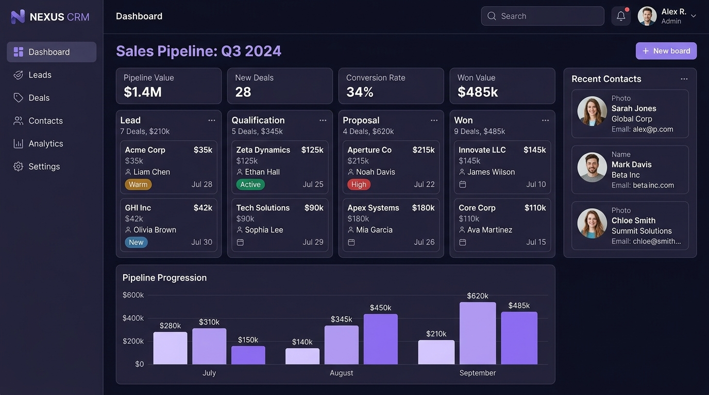

# Dashboard Tour

The **HubNest OS Workspace** is engineered to eliminate browser tab clutter by hosting all your core business tools within a single, distraction-free desktop window.

{ align=center style="border-radius: 8px; box-shadow: 0 4px 20px rgba(0,0,0,0.15); margin-bottom: 2rem;" }

---

## 1. Key Interface Areas

```text
┌────────────────────────────────────────────────────────────────────────┐
│  [Logo] HubNest OS    [ CRM ] [ HRMS ] [ Meet ] [+]       [_] [口] [X]  │ <-- Top Tab Bar
├───────┬────────────────────────────────────────────────────────────────┤
│ [CRM] │  Dashboard > Sales Pipeline Q3                                 │
│ [HRM] │                                                                │
│ [MET] │  ┌───────────────┐ ┌───────────────┐ ┌──────────────────────┐  │ <-- Main Hub View
│ [VOI] │  │ Pipeline $1.4M│ │ New Deals: 28 │ │ Conversion: 34%      │  │
│ [NOT] │  └───────────────┘ └───────────────┘ └──────────────────────┘  │
│       │                                                                │
│ [CFG] │  [Lead]   [Qualification]   [Proposal]   [Won]                 │
│ [USR] │                                                                │
└───────┴────────────────────────────────────────────────────────────────┘
  ^-- Left Hub Rail
```

### 1. Left Hub Rail (App Switcher)
The permanent vertical bar on the left allows instant one-click switching between active operational hubs:
* **CRM**: Sales pipeline, leads, deals, quotations.
* **HRMS**: Attendance, employee records, leave approvals, payroll.
* **HubMeet**: Video calls, meetings, recordings, whiteboard.
* **Calling**: Softphone dialer, call queues, call history.
* **Notifications**: WhatsApp campaigns, SMS alerts, templates.
* **Settings & Admin**: Workspace preferences and organization setup.

### 2. Top Multi-Hub Tab Bar
HubNest OS supports browser-style tabs for your hubs:
* Open multiple modules simultaneously (e.g., have **HubCRM** open in Tab 1 while conducting a video interview in **HubMeet** on Tab 2).
* Click the **`+`** icon to open a new hub view.
* Click **`x`** to close an inactive hub tab.

### 3. Main Workspace Area
The primary canvas displaying the active hub's interface, rendered via high-performance Microsoft Edge WebView2 technology.

### 4. Header Bar (Search & User Menu)
* **Global Search (`Ctrl + K`)**: Instantly search for customer names, deals, employees, or meeting rooms across all hubs.
* **Notification Bell**: Displays incoming task assignments, meeting invites, and leave approval requests.
* **User Profile**: Quick access to profile settings, light/dark theme toggle, and logout.

---

## 2. Notification Center & System Tray

HubNest OS remains connected in the Windows System Tray even when the main window is minimized:
* **Incoming Call Alerts**: Pops up a native desktop banner with caller ID and Accept/Decline buttons.
* **Meeting Reminders**: Alerts you 5 minutes before scheduled HubMeet calls.
* **Background Tray Icon**: Right-click the HubNest icon in the taskbar tray to quickly mute audio, change status (Available, Busy, Away), or quit the application.

---

## 3. Light and Dark Mode Themes

HubNest automatically inherits your Windows system theme by default, but allows manual override:
1. Click your **Profile Icon** in the top-right header.
2. Toggle the **Dark Mode** switch.
3. The interface instantly shifts between sleek deep-purple dark mode and clean corporate light mode.
