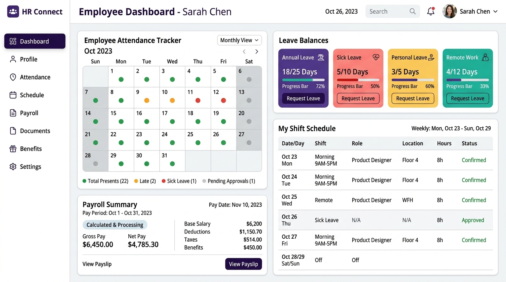
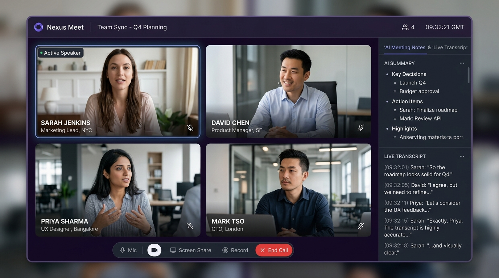

# First Task Checklist

To help you get immediate value from HubNest, complete the checklist matching your role during your first day on the platform.

---

## 👔 Administrator / Business Owner Checklist

Reach your first milestone: a fully configured company workspace with your team onboarded.

- [ ] **1. Download & Launch HubNest OS**: Install `HubNestOS-Setup.msi` on your primary workstation.
- [ ] **2. Sign in with Admin Credentials**: Log in using your registered enterprise email.
- [ ] **3. Configure Organization Profile**: Upload your company logo and set default currency (`INR ₹` / `USD $`).
- [ ] **4. Verify Active Subscriptions**: Check **Billing** to ensure your purchased hub licenses are active.
- [ ] **5. Invite Initial Team Members**: Add at least 2 team members (e.g., your HR lead and Sales manager).
- [ ] **6. Assign Role-Based Permissions**: Verify that sales reps only see CRM and HR staff only see HRMS.
- [ ] **7. Verify Notification Channel**: Connect company email or WhatsApp gateway.

---

## 💼 Sales Representative Checklist

Reach your first milestone: adding a prospect, creating a deal, and generating a client quotation.

{ align=center style="border-radius: 8px; box-shadow: 0 4px 15px rgba(0,0,0,0.1); margin-bottom: 1.5rem;" }

- [ ] **1. Open HubCRM**: Click the **CRM** icon on the left rail.
- [ ] **2. Create Your First Lead**: Click **+ New Lead**, enter customer name, company, email, and estimated deal value.
- [ ] **3. Move Lead on the Kanban Board**: Drag the lead card from **New** to **Qualified**.
- [ ] **4. Log a Call or Meeting**: Schedule a follow-up HubMeet call directly from the deal card.
- [ ] **5. Generate a PDF Quotation**: Click **Create Quote**, select service items, apply any discounts, and click **Export PDF**.
- [ ] **6. Send via WhatsApp / Email**: Deliver the quotation directly to the client's inbox or phone.

---

## 👩‍💼 HR Manager / Recruiter Checklist

Reach your first milestone: setting up your employee roster and reviewing shift attendance.

{ align=center style="border-radius: 8px; box-shadow: 0 4px 15px rgba(0,0,0,0.1); margin-bottom: 1.5rem;" }

- [ ] **1. Open HubHRMS**: Click the **HRMS** icon in the sidebar.
- [ ] **2. Add Departments**: Create core departments (e.g., Engineering, Sales, Marketing, Operations).
- [ ] **3. Add Employee Profiles**: Enter staff names, work emails, designation, joining date, and salary structure.
- [ ] **4. Define Shift Timings**: Create default work shifts (e.g., General Shift: 9:30 AM to 6:30 PM).
- [ ] **5. Test Leave Quotas**: Configure annual paid leave and sick leave allocations.
- [ ] **6. Review Daily Attendance**: View the live attendance dashboard to monitor clock-in timestamps.

---

## 🤝 Standard Employee Checklist

Reach your first milestone: joining a team video call and submitting daily attendance.

{ align=center style="border-radius: 8px; box-shadow: 0 4px 15px rgba(0,0,0,0.1); margin-bottom: 1.5rem;" }

- [ ] **1. Log In to HubNest OS**: Complete first-time password setup.
- [ ] **2. Update Profile & Photo**: Upload a profile photo and verify your phone number.
- [ ] **3. Clock In Daily Attendance**: Click **Clock In** on the HRMS self-service widget.
- [ ] **4. Test Camera & Microphone**: Open **HubMeet** and join the test room to verify audio/video clarity.
- [ ] **5. Toggle Noise Cancellation**: Enable AI noise cancellation to filter keyboard clicks and background noise.
