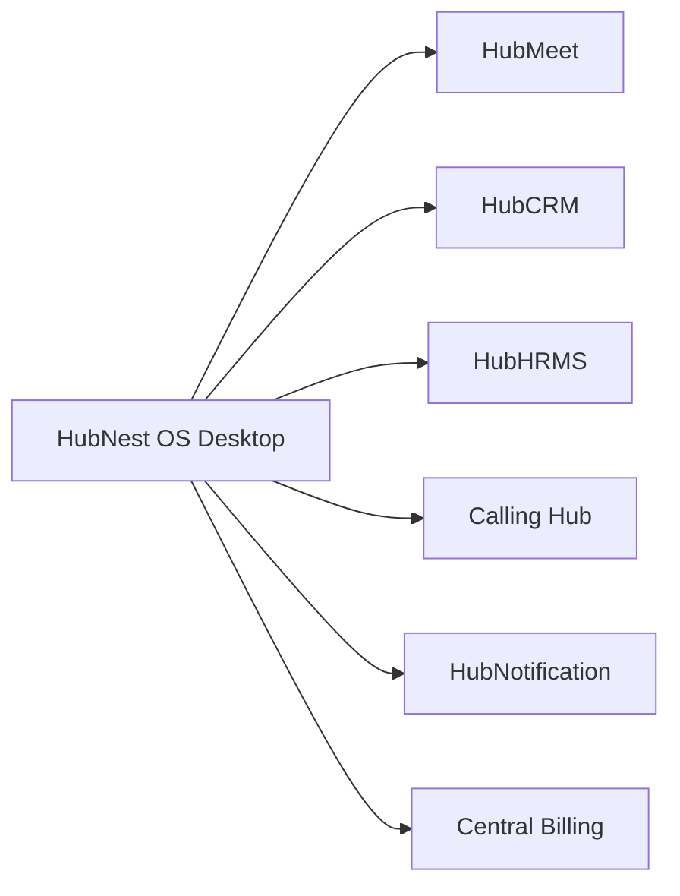

# Getting Started with HubNest

HubNest is an all-in-one business operations workspace designed to unite your communications, CRM, HR management, VoIP calling, and messaging into one unified desktop and cloud environment.

---

## 🧭 In This Section

1. **[Installing Desktop App](installing-desktop-app.md)**: Download and set up HubNest OS on Windows 10/11.
2. **[Account & First Login](login-and-setup.md)**: Log in with enterprise Single Sign-On (SSO) and set up your profile.

---

## 🌟 The HubNest Ecosystem

!!! info "Multi-Tenant Workspace"
    Your account is linked to your organization's tenant. You only see the hubs and tools that your administrator or subscription tier has granted to you.
